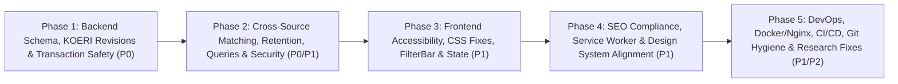

# Comprehensive Phased Implementation Plan: Resolving All Issues in `PROJECT_REVIEW.md`

This plan addresses **every single issue** documented in [`PROJECT_REVIEW.md`](file:///C:/Users/LENOVO/IdeaProjects/deprem/PROJECT_REVIEW.md), organized into **5 sequential, independently verifiable phases** with exact file paths, line numbers, code modifications, and test coverage requirements.



---

## Phase 1: Database Schema Hardening, KOERI Revision Identity & Transaction Safety (P0)

**Goal:** Prevent duplicate KOERI earthquake reports when revisions shift time/coordinates, eliminate the Spring `@Transactional` rollback trap between ingestion and matching, enforce database-level uniqueness on cross-source matches, and prevent concurrent poller race conditions.

### Task 1.1: Create Flyway Migration `V3__event_match_constraints_and_indexes.sql`
- **File to Create:** `src/main/resources/db/migration/V3__event_match_constraints_and_indexes.sql`
- **File to Modify:** [`EventMatch.java`](file:///C:/Users/LENOVO/IdeaProjects/deprem/src/main/java/com/ag/deprem/model/entity/EventMatch.java#L8-L10)
- **Why:** Currently `event_match` (`V1` lines 38–48, `V2` lines 10–18) has no `UNIQUE(left_report_id, right_report_id)` constraint or self-match `CHECK` constraint, allowing concurrent pollers to insert duplicate match rows.
- **How to Implement:**
  1. In `V3__event_match_constraints_and_indexes.sql`:
     - Deduplicate any potential existing duplicate `(left_report_id, right_report_id)` rows in `event_match` (keeping the latest `updated_at`).
     - Add `CONSTRAINT uq_event_match_reports UNIQUE (left_report_id, right_report_id)`.
     - Add `CONSTRAINT chk_event_match_distinct_reports CHECK (left_report_id <> right_report_id)`.
     - Add composite index `CREATE INDEX IF NOT EXISTS idx_revision_report_occurred ON source_report_revision(occurred_at, latitude, longitude);` to accelerate spatio-temporal revision lookups.
  2. In [`EventMatch.java`](file:///C:/Users/LENOVO/IdeaProjects/deprem/src/main/java/com/ag/deprem/model/entity/EventMatch.java#L8), update `@Table(name = "event_match", uniqueConstraints = @UniqueConstraint(name = "uq_event_match_reports", columnNames = {"left_report_id", "right_report_id"}))`.

### Task 1.2: Fix KOERI Revision Identity Resolution (`KoeriDataNormalizer` & `IngestionService`)
- **Files to Modify:**
  - [`KoeriDataNormalizer.java`](file:///C:/Users/LENOVO/IdeaProjects/deprem/src/main/java/com/ag/deprem/service/KoeriDataNormalizer.java#L62-L108)
  - [`SourceReportRevisionRepository.java`](file:///C:/Users/LENOVO/IdeaProjects/deprem/src/main/java/com/ag/deprem/repository/SourceReportRevisionRepository.java#L26-L28)
  - [`IngestionService.java`](file:///C:/Users/LENOVO/IdeaProjects/deprem/src/main/java/com/ag/deprem/service/IngestionService.java#L142-L203)
- **Why:** `KoeriDataNormalizer` (lines 63–65) generates `koeri-yyyyMMddHHmmss-lat-lon`. When KOERI publishes a revised solution (`Revize Edilmiş`) whose timestamp shifts by 1–10 seconds or coordinates shift by `0.0001°–0.05°`, `findBySourceAndSourceEventId` returns `Optional.empty()`, inserting a brand-new `SourceReport` instead of adding Revision #2 to the existing report. Additionally, line 104 hardcodes `dto.setIsEventUpdate(false);` even when `solutionQuality` contains `"Revize"`.
- **How to Implement:**
  1. **In [`KoeriDataNormalizer.java`](file:///C:/Users/LENOVO/IdeaProjects/deprem/src/main/java/com/ag/deprem/service/KoeriDataNormalizer.java#L100-L108):**
     - Detect whether `quality` indicates a revision (`quality != null && quality.toUpperCase(Locale.ROOT).contains("REV")`) and set `dto.setIsEventUpdate(isRevision)`.
     - Make `computeNormalizedHash(NormalizedReportDto dto)` (lines 174–186) public or package-private (or exclude `sourceEventId` from `computeNormalizedHash`, since `sourceEventId` is already the report identity and revisions of the same report share the report's `sourceEventId`).
  2. **In [`SourceReportRevisionRepository.java`](file:///C:/Users/LENOVO/IdeaProjects/deprem/src/main/java/com/ag/deprem/repository/SourceReportRevisionRepository.java#L27):**
     - Add query method:
       ```java
       @Query("SELECT r FROM SourceReportRevision r JOIN FETCH r.sourceReport sr WHERE r.id = sr.currentRevisionId AND sr.source = :source AND r.occurredAt >= :start AND r.occurredAt <= :end")
       List<SourceReportRevision> findCurrentRevisionsBySourceBetween(@Param("source") String source, @Param("start") Instant start, @Param("end") Instant end);
       ```
  3. **In [`IngestionService.java`](file:///C:/Users/LENOVO/IdeaProjects/deprem/src/main/java/com/ag/deprem/service/IngestionService.java#L142-L145):**
     - When `existingOpt.isEmpty()` and `"KOERI".equals(dto.getSource())`, call a helper `resolveExistingKoeriReport(NormalizedReportDto dto)` that queries `revisionRepository.findCurrentRevisionsBySourceBetween("KOERI", dto.getOccurredAt().minusSeconds(15), dto.getOccurredAt().plusSeconds(15))`.
     - Among candidates within `<= 15.0 km` (using `EventMatchingService.haversineDistanceKm(dto.getLatitude(), dto.getLongitude(), cand.getLatitude(), cand.getLongitude())`) and magnitude difference `<= 0.8` (if both have magnitudes), select the closest candidate if either `Boolean.TRUE.equals(dto.getIsEventUpdate())` or `(timeDeltaSeconds <= 5 && distanceKm <= 5.0)`.
     - When matched to an existing KOERI `SourceReport`, adopt `existingReport.getSourceEventId()` on `dto` and route execution into the `else` branch (lines 170–202) so a new `SourceReportRevision` (`revisionNumber + 1`, `isEventUpdate = true`) is created on the existing `SourceReport`!

### Task 1.3: Fix Nested `@Transactional` Rollback Trap in `IngestionService` & `EventMatchingService`
- **Files to Modify:**
  - [`IngestionService.java`](file:///C:/Users/LENOVO/IdeaProjects/deprem/src/main/java/com/ag/deprem/service/IngestionService.java#L126-L206)
  - [`EventMatchingService.java`](file:///C:/Users/LENOVO/IdeaProjects/deprem/src/main/java/com/ag/deprem/service/EventMatchingService.java#L72-L74), [`EventMatchingService.java`](file:///C:/Users/LENOVO/IdeaProjects/deprem/src/main/java/com/ag/deprem/service/EventMatchingService.java#L287-L289)
- **Why:** `IngestionService.ingestReports` is `@Transactional` and wraps calls to `matchingService.evaluateMatchesForReport` / `handleRevisionChange` in `try/catch`. Because `EventMatchingService` uses default `@Transactional(propagation = Propagation.REQUIRED)`, any runtime exception inside `EventMatchingService` marks the outer transaction `rollbackOnly = true`, rolling back the entire batch of ingested earthquakes with `UnexpectedRollbackException`.
- **How to Implement:**
  1. In [`IngestionService.java`](file:///C:/Users/LENOVO/IdeaProjects/deprem/src/main/java/com/ag/deprem/service/IngestionService.java#L126-L206):
     - Collect a list of newly inserted `(SourceReport, SourceReportRevision)` pairs and updated `(SourceReport, SourceReportRevision)` pairs during the persistence loop, call `sourceReportRepository.flush()` and `revisionRepository.flush()`, or run per-report ingestion via `TransactionTemplate` / separate transactional helper `upsertSingleReport(NormalizedReportDto dto, Instant now)` so that:
       1. One malformed/conflicting report cannot roll back the entire batch of 100–500 reports.
       2. Matching (`matchingService.evaluateMatchesForReport` / `handleRevisionChange`) is invoked **after** the report & revision transaction has committed (or inside its own isolated `@Transactional(propagation = Propagation.REQUIRES_NEW)` transaction after flush).
  2. Annotate `evaluateMatchesForReport` (line 72) and `handleRevisionChange` (line 287) in [`EventMatchingService.java`](file:///C:/Users/LENOVO/IdeaProjects/deprem/src/main/java/com/ag/deprem/service/EventMatchingService.java#L72) with `@Transactional(propagation = Propagation.REQUIRES_NEW)` (or keep `@Transactional` when called outside an active transaction).

### Task 1.4: Add Single-Flight Concurrency Guards to `AfadScheduledPoller` & `AfadBackfillService`
- **Files to Modify:**
  - [`AfadScheduledPoller.java`](file:///C:/Users/LENOVO/IdeaProjects/deprem/src/main/java/com/ag/deprem/service/AfadScheduledPoller.java#L16-L47)
  - [`AfadBackfillService.java`](file:///C:/Users/LENOVO/IdeaProjects/deprem/src/main/java/com/ag/deprem/service/AfadBackfillService.java#L15-L131)
- **Why:** Unlike `KoeriScheduledPoller` (which has `AtomicBoolean isPolling`), `AfadScheduledPoller` and `AfadBackfillService` lack single-flight protection and can run concurrently with each other or overlapping `POST /api/v1/archive/backfill` requests.
- **How to Implement:**
  1. Add `private final AtomicBoolean isPolling = new AtomicBoolean(false);` to [`AfadScheduledPoller.java`](file:///C:/Users/LENOVO/IdeaProjects/deprem/src/main/java/com/ag/deprem/service/AfadScheduledPoller.java#L22), guarding `pollRecentEvents()` with `if (!isPolling.compareAndSet(false, true)) return;` and `finally { isPolling.set(false); }`.
  2. Add `private final AtomicBoolean isBackfilling = new AtomicBoolean(false);` to [`AfadBackfillService.java`](file:///C:/Users/LENOVO/IdeaProjects/deprem/src/main/java/com/ag/deprem/service/AfadBackfillService.java#L24), guarding `runBackfill(Instant start, Instant end)` and throwing `IllegalStateException("Backfill operation is already in progress")` (or skipping in `scheduledDailyBackfill`) with `finally { isBackfilling.set(false); }`.

### Task 1.5: Fix `KoeriApiClient`, `KoeriScheduledPoller`, and `KoeriPageParser` Status & HTTPS Handling
- **Files to Modify:**
  - [`application.properties`](file:///C:/Users/LENOVO/IdeaProjects/deprem/src/main/resources/application.properties#L61)
  - [`KoeriApiClient.java`](file:///C:/Users/LENOVO/IdeaProjects/deprem/src/main/java/com/ag/deprem/service/KoeriApiClient.java#L33-L70)
  - [`KoeriScheduledPoller.java`](file:///C:/Users/LENOVO/IdeaProjects/deprem/src/main/java/com/ag/deprem/service/KoeriScheduledPoller.java#L39-L51)
  - [`KoeriPageParser.java`](file:///C:/Users/LENOVO/IdeaProjects/deprem/src/main/java/com/ag/deprem/service/KoeriPageParser.java#L75-L95)
  - [`SourceStatusTracker.java`](file:///C:/Users/LENOVO/IdeaProjects/deprem/src/main/java/com/ag/deprem/service/SourceStatusTracker.java#L36-L48)
- **Why:**
  - Default KOERI URL uses plaintext `http://` instead of `https://` (`application.properties:61`, `KoeriApiClient.java:33`).
  - `KoeriApiClient.fetchRawPage()` (line 66) calls `statusTracker.recordSuccess("KOERI", now)` *before* `KoeriPageParser` parses the HTML. If KOERI serves an HTML error page or changes layout (0 events parsed), status still reports `"current"`.
  - `KoeriPageParser` (line 79) splits location and quality via `remaining.split("\\s{2,}")` and takes `parts[0]` as location and `parts[parts.length - 1]` as quality, which drops middle tokens if a location name contains double spaces.
- **How to Implement:**
  1. Update default URL in [`application.properties:61`](file:///C:/Users/LENOVO/IdeaProjects/deprem/src/main/resources/application.properties#L61) and [`KoeriApiClient.java:33`](file:///C:/Users/LENOVO/IdeaProjects/deprem/src/main/java/com/ag/deprem/service/KoeriApiClient.java#L33) to `https://www.koeri.boun.edu.tr/scripts/lst0.asp`.
  2. Remove `statusTracker.recordSuccess("KOERI", now)` from `KoeriApiClient.fetchRawPage()` (line 66). Instead, in [`KoeriScheduledPoller.java`](file:///C:/Users/LENOVO/IdeaProjects/deprem/src/main/java/com/ag/deprem/service/KoeriScheduledPoller.java#L41-L50):
     - If `events.isEmpty() && parseResult.getTotalLines() > 0`, call `statusTracker.recordFailure("KOERI", Instant.now(), "KOERI page parsed 0 events out of " + parseResult.getTotalLines() + " lines")`.
     - Only call `statusTracker.recordSuccess("KOERI", Instant.now())` when `!events.isEmpty()` (or when `preMatcher.find()` succeeded with valid structure and 0 lines).
  3. In [`KoeriPageParser.java`](file:///C:/Users/LENOVO/IdeaProjects/deprem/src/main/java/com/ag/deprem/service/KoeriPageParser.java#L79-L86), when `parts.length >= 2`, join `Arrays.copyOfRange(parts, 0, parts.length - 1)` with `" "` as `location` and use `parts[parts.length - 1]` as `solutionQuality`, so multi-part location strings separated by 2+ spaces are never truncated.

---

## Phase 2: Cross-Source Matching Rules, Retention Safety, Query Service & Security Hardening (P0/P1)

**Goal:** Align `EventMatchingService` with `KANDILLI_MATCHING_IMPLEMENTATION_PLAN.md`, preserve match data across 30-day retention, fix `EarthquakeQueryService` bugs, and eliminate the `SeoController` Host-header cache poisoning vulnerability.

### Task 2.1: Fix `EventMatchingService` Scale Compatibility, Manual Decision Protection & Group Sync
- **File to Modify:** [`EventMatchingService.java`](file:///C:/Users/LENOVO/IdeaProjects/deprem/src/main/java/com/ag/deprem/service/EventMatchingService.java#L96-L300)
- **Why:**
  1. Lines 107–110 and 185–186 compare `magnitudeValue` across incompatible scales (e.g., KOERI `MD`/`ML` vs AFAD `Mw`).
  2. Lines 209–232 (`saveOrUpdateMatch`) overwrite `MANUAL_MATCHED` and `REJECTED` decisions with `decisionType = "AUTO"`.
  3. Lines 235–300 (`linkReportsInEventGroup` & `handleRevisionChange`) never remove or update `EventGroupMember` rows when a match is marked `SUPERSEDED`, and do not prevent two reports from the same source (`AFAD`+`AFAD` or `KOERI`+`KOERI`) from joining the same `EventGroup`.
- **How to Implement:**
  1. **Comparable Magnitude Delta Helper (`computeComparableMagnitudeDelta(SourceReportRevision revA, SourceReportRevision revB)`):**
     - Replace raw `Math.abs(revA.getMagnitudeValue() - revB.getMagnitudeValue())` at lines 107–110 and 185–186 with a helper that checks:
       - First, if both have `magMw != null`, return `Math.abs(revA.getMagMw() - revB.getMagMw())`.
       - Else if both have `magMl != null`, return `Math.abs(revA.getMagMl() - revB.getMagMl())`.
       - Else if both have `magMd != null`, return `Math.abs(revA.getMagMd() - revB.getMagMd())`.
       - Else if `revA.getMagnitudeType() != null && revA.getMagnitudeType().equalsIgnoreCase(revB.getMagnitudeType()) && revA.getMagnitudeValue() != null && revB.getMagnitudeValue() != null`, return `Math.abs(revA.getMagnitudeValue() - revB.getMagnitudeValue())`.
       - Otherwise return `null` (so `computeScore` neither awards the `+0.05` comparable-magnitude bonus nor applies the `-0.10` penalty for different scales, per `KANDILLI_MATCHING_IMPLEMENTATION_PLAN.md:72`).
  2. **Protect Manual Decisions in `saveOrUpdateMatch` (lines 209–232) and `evaluateMatchesForReport`:**
     - After looking up `existingMatch` via `matchRepository.findMatchBetweenReports(leftRep.getId(), rightRep.getId())`:
       ```java
       if (existingMatch.isPresent()) {
           EventMatch existing = existingMatch.get();
           if ("MANUAL".equalsIgnoreCase(existing.getDecisionType())
                   || "MANUAL_MATCHED".equals(existing.getStatus())
                   || "REJECTED".equals(existing.getStatus())) {
               log.debug("Preserving manual match decision ({}) between {} and {}",
                       existing.getStatus(), leftRep.getId(), rightRep.getId());
               return;
           }
       }
       ```
  3. **Same-Source Guard & Group Cleanup in `linkReportsInEventGroup` (lines 235–265) and `handleRevisionChange` (lines 287–300):**
     - In `linkReportsInEventGroup`: Before adding a report to an existing `targetGroup`, fetch `memberRepository.findByEventGroupId(targetGroup.getId())` and verify no existing member in `targetGroup` has the same `sourceReport.getSource()`. If a same-source report already exists in `targetGroup`, do not merge into `targetGroup`.
     - In `handleRevisionChange` (lines 289–299): When marking an existing `AUTO_MATCHED` match as `SUPERSEDED`, also check `memberRepository.findBySourceReportId(report.getId())`. If `AUTO` membership exists, remove the `EventGroupMember` rows for that group (and delete the `EventGroup` if no members remain) before re-running `evaluateMatchesForReport(report, newRevision)`.

### Task 2.2: Preserve Match Info in Archive Shards & Clean Orphaned `EventGroup`s on Retention
- **Files to Modify:**
  - [`ArchiveExporterService.java`](file:///C:/Users/LENOVO/IdeaProjects/deprem/src/main/java/com/ag/deprem/service/ArchiveExporterService.java#L27-L45), [`ArchiveExporterService.java`](file:///C:/Users/LENOVO/IdeaProjects/deprem/src/main/java/com/ag/deprem/service/ArchiveExporterService.java#L213-L242)
  - [`EventGroupRepository.java`](file:///C:/Users/LENOVO/IdeaProjects/deprem/src/main/java/com/ag/deprem/repository/EventGroupRepository.java#L17-L25)
  - [`DataRetentionService.java`](file:///C:/Users/LENOVO/IdeaProjects/deprem/src/main/java/com/ag/deprem/service/DataRetentionService.java#L27-L99)
- **Why:** When `DataRetentionService` deletes 30-day-old `SourceReport` rows, `ON DELETE CASCADE` deletes `event_match` and `event_group_member` rows, losing match associations in exported archives and leaving empty `event_group` rows orphaned in PostgreSQL.
- **How to Implement:**
  1. Inject `EventMatchRepository` into [`ArchiveExporterService.java`](file:///C:/Users/LENOVO/IdeaProjects/deprem/src/main/java/com/ag/deprem/service/ArchiveExporterService.java#L35). In `mapToItemDto(SourceReportRevision rev)` (lines 213–241), query `matchRepository.findAllByReportId(report.getId())` for an active match (`AUTO_MATCHED` or `MANUAL_MATCHED`) and populate `dto.setMatchStatus(activeMatch.getStatus())` and `dto.setMatchedEventId(partner.getSourceEventId())`.
  2. In [`EventGroupRepository.java`](file:///C:/Users/LENOVO/IdeaProjects/deprem/src/main/java/com/ag/deprem/repository/EventGroupRepository.java#L24), add:
     ```java
     @Modifying
     @Query("DELETE FROM EventGroup g WHERE g.members IS EMPTY")
     int deleteEmptyGroups();
     ```
  3. Inject `EventGroupRepository` into [`DataRetentionService.java`](file:///C:/Users/LENOVO/IdeaProjects/deprem/src/main/java/com/ag/deprem/service/DataRetentionService.java#L35). After `sourceReportRepository.deleteAll(oldReports);` and `sourceReportRepository.flush();` (line 94), call `int orphanedGroups = eventGroupRepository.deleteEmptyGroups();` and log the count.

### Task 2.3: Fix `EarthquakeQueryService` Detail Lookup, Per-Source Freshness, Per-Source Coverage & List Match Badges
- **Files to Modify:**
  - [`SourceReportRevisionRepository.java`](file:///C:/Users/LENOVO/IdeaProjects/deprem/src/main/java/com/ag/deprem/repository/SourceReportRevisionRepository.java#L29-L34)
  - [`EventMatchRepository.java`](file:///C:/Users/LENOVO/IdeaProjects/deprem/src/main/java/com/ag/deprem/repository/EventMatchRepository.java#L19-L23)
  - [`EarthquakeQueryService.java`](file:///C:/Users/LENOVO/IdeaProjects/deprem/src/main/java/com/ag/deprem/service/EarthquakeQueryService.java#L140-L246)
- **Why:**
  1. `queryEarthquakes` (lines 155–159) always hardcodes `new FreshnessDto("AFAD", ...)` even when `source` filter is `"KOERI"`.
  2. `queryEarthquakes` (lines 143–145) never populates `matchStatus` or `matchedEventId` on list items (`EarthquakeItemDto`), meaning the `"Eşleşti"` badge in `EarthquakeList.tsx` (lines 180–184) **never renders in the list**!
  3. `getEarthquakeDetail` (lines 185–198) uses `revisions.get(0)` instead of resolving `report.getCurrentRevisionId()`.
  4. `getStatus()` (lines 222–246) uses global `findEarliestOccurredAt()` and `findLatestOccurredAt()` across all sources instead of per-source coverage dates.
- **How to Implement:**
  1. In [`SourceReportRevisionRepository.java`](file:///C:/Users/LENOVO/IdeaProjects/deprem/src/main/java/com/ag/deprem/repository/SourceReportRevisionRepository.java#L29-L34), add per-source aggregate queries:
     ```java
     @Query("SELECT MAX(r.occurredAt) FROM SourceReportRevision r WHERE r.sourceReport.source = :source")
     Optional<Instant> findLatestOccurredAtBySource(@Param("source") String source);

     @Query("SELECT MIN(r.occurredAt) FROM SourceReportRevision r WHERE r.sourceReport.source = :source")
     Optional<Instant> findEarliestOccurredAtBySource(@Param("source") String source);
     ```
  2. In [`EventMatchRepository.java`](file:///C:/Users/LENOVO/IdeaProjects/deprem/src/main/java/com/ag/deprem/repository/EventMatchRepository.java#L20), add a batch query to avoid $N+1$ queries when rendering pages of 100–500 items:
     ```java
     @Query("SELECT m FROM EventMatch m JOIN FETCH m.leftReport JOIN FETCH m.rightReport WHERE (m.leftReport.id IN :reportIds OR m.rightReport.id IN :reportIds) AND m.status IN ('AUTO_MATCHED', 'MANUAL_MATCHED')")
     List<EventMatch> findActiveMatchesByReportIds(@Param("reportIds") Collection<UUID> reportIds);
     ```
  3. In [`EarthquakeQueryService.java`](file:///C:/Users/LENOVO/IdeaProjects/deprem/src/main/java/com/ag/deprem/service/EarthquakeQueryService.java):
     - In `queryEarthquakes` (lines 141–160): Batch-fetch active matches for the page's report IDs via `findActiveMatchesByReportIds` and populate `dto.setMatchStatus(...)` and `dto.setMatchedEventId(...)` on each `EarthquakeItemDto`.
     - In `queryEarthquakes` (lines 155–159): If `source != null && "KOERI".equalsIgnoreCase(source.trim())`, build `FreshnessDto` using `"KOERI"`, `statusTracker.getState("KOERI").getLastSuccessfulFetchAt()`, and `statusTracker.getState("KOERI").getFreshnessStatus(now)`.
     - In `getEarthquakeDetail` (lines 185–201): Resolve `currentRev` by matching `r.getId().equals(report.getCurrentRevisionId())` with fallback to `revisions.get(0)`, and for the matched partner use `partner.getCurrentRevisionId()` via `revisionRepository.findById(...)` with fallback to `findFirstBySourceReportIdOrderByRevisionNumberDesc`.
     - In `getStatus()` (lines 222–246): Populate each `SourceStatusDto`'s `coverageFrom` and `latestEventAt` using `findEarliestOccurredAtBySource(sourceName)` and `findLatestOccurredAtBySource(sourceName)`.

### Task 2.4: Fix Host-Header Injection in `SeoController` & JSON Escaping in `IndexNowService`
- **Files to Modify:**
  - [`SeoController.java`](file:///C:/Users/LENOVO/IdeaProjects/deprem/src/main/java/com/ag/deprem/controller/SeoController.java#L20-L145)
  - [`IndexNowService.java`](file:///C:/Users/LENOVO/IdeaProjects/deprem/src/main/java/com/ag/deprem/service/IndexNowService.java#L50-L75)
- **Why:**
  - `SeoController.resolveBaseUrl` (line 117) has `!baseUrl.contains("depremizleme.com")` which ignores `app.site.base-url` when set to `depremizleme.com`, and trusts raw `X-Forwarded-Host` / `X-Forwarded-Proto` headers without validation on publicly cached `/sitemap.xml` and `/robots.txt` responses.
  - `IndexNowService` builds JSON via `String.format` without escaping quotes, instead of serializing a Map/DTO or escaping strings.
- **How to Implement:**
  1. In [`SeoController.java`](file:///C:/Users/LENOVO/IdeaProjects/deprem/src/main/java/com/ag/deprem/controller/SeoController.java#L116-L145):
     - Remove `&& !baseUrl.contains("depremizleme.com")` from line 117 so any configured `app.site.base-url` is strictly honored.
     - Validate `proto` to only allow `"http"` or `"https"` (defaulting to `"https"` if invalid).
     - Validate `host` against a strict hostname regex `^[a-zA-Z0-9.-]+(:[0-9]{1,5})?$` (stripping any comma-separated proxy list by taking the first token before validation); if validation fails, fall back to `"localhost:8080"`.
     - Escape XML special characters in `<loc>` values in `getSitemapXml()`.
  2. In [`IndexNowService.java`](file:///C:/Users/LENOVO/IdeaProjects/deprem/src/main/java/com/ag/deprem/service/IndexNowService.java#L50-L75):
     - Pass a `Map<String, Object>` (`host`, `key`, `keyLocation`, `urlList`) directly to `restClient.post()...body(payloadMap)` so Jackson serializes and escapes the JSON safely.

---

## Phase 3: Frontend Accessibility, CSS Fixes, FilterBar & State Management (P1)

**Goal:** Restore full WCAG 2.1.1 keyboard accessibility on earthquake cards, fix all mismatched/missing CSS classes across modals and cards, fix the `FilterBar` `M ≥ 4.5` bug and add a Source filter (`AFAD` / `Kandilli`), synchronize province routing and map centering, and eliminate async request race conditions.

### Task 3.1: Restore Keyboard Navigation on Earthquake Cards & Fix Missing/Mismatched Copy
- **File to Modify:** [`frontend/src/components/EarthquakeList.tsx`](file:///C:/Users/LENOVO/IdeaProjects/deprem/frontend/src/components/EarthquakeList.tsx#L140-L215)
- **Why:**
  - `<article className="earthquake-card">` (lines 141–146) has `onClick={() => onSelect(item)}` but lacks `tabIndex={0}` and `onKeyDown`, making cards unreachable via keyboard (`Tab` / `Enter` / `Space`).
  - Line 149 uses `'-'` and Line 171 uses `'Bilinmiyor'` instead of `'Raporlanmadı'` (`DESIGN.md:166`).
  - Line 165 uses `className="card-details"` (instead of `card-specs card-details`) and Line 206 uses `className="list-load-more"` (instead of `list-load-more-container`).
- **How to Implement:**
  1. In [`EarthquakeList.tsx`](file:///C:/Users/LENOVO/IdeaProjects/deprem/frontend/src/components/EarthquakeList.tsx#L141-L147), add keyboard interactivity to `<article>`:
     ```tsx
     <article
       key={item.id}
       className={`earthquake-card ${isSelected ? 'selected' : ''}`}
       tabIndex={0}
       aria-current={isSelected ? 'true' : undefined}
       aria-label={`${loc.displayTitle}, Büyüklük ${magVal !== null && magVal !== undefined ? magVal.toFixed(1) : 'Raporlanmadı'}, Derinlik ${item.depthKm !== null ? `${item.depthKm} km` : 'Raporlanmadı'}`}
       onClick={() => onSelect(item)}
       onKeyDown={(e) => {
         if (e.target !== e.currentTarget) return;
         if (e.key === 'Enter' || e.key === ' ') {
           e.preventDefault();
           onSelect(item);
         }
       }}
     >
     ```
  2. On line 171, replace `'Bilinmiyor'` with `'Raporlanmadı'`.
  3. On line 165, use `className="card-specs card-details"`; on line 206, use `className="list-load-more-container"`.
  4. Move the inline style on `.btn-error-retry` (line 73) into `App.css`.

### Task 3.2: Fix Mismatched & Missing CSS Rules in `App.css`, `InfoModal.tsx`, and `EarthquakeDetailModal.tsx`
- **Files to Modify:**
  - [`frontend/src/components/InfoModal.tsx`](file:///C:/Users/LENOVO/IdeaProjects/deprem/frontend/src/components/InfoModal.tsx#L86)
  - [`frontend/src/components/EarthquakeDetailModal.tsx`](file:///C:/Users/LENOVO/IdeaProjects/deprem/frontend/src/components/EarthquakeDetailModal.tsx#L188-L398)
  - [`frontend/src/App.css`](file:///C:/Users/LENOVO/IdeaProjects/deprem/frontend/src/App.css#L541-L895)
- **Why:**
  - `InfoModal.tsx:86` uses `className="btn-close-modal"` while `App.css:687` defines `.btn-modal-close`, leaving the close button unstyled.
  - `App.css:891` references `animation: fadeIn 0.15s ease;` without defining `@keyframes fadeIn`.
  - `EarthquakeDetailModal.tsx` uses `.modal-loader` (line 178) and `.modal-error` (line 185) which have no CSS rules in `App.css`, and uses `'Bilinmiyor'` / `'Yok'` (lines 194, 205) instead of `'Raporlanmadı'` and `http://www.koeri.boun.edu.tr/scripts/lst0.asp` (line 395).
- **How to Implement:**
  1. In [`InfoModal.tsx:86`](file:///C:/Users/LENOVO/IdeaProjects/deprem/frontend/src/components/InfoModal.tsx#L86), change `className="btn-close-modal"` to `className="btn-modal-close"` (and also selector-alias `.btn-modal-close, .btn-close-modal` in `App.css:687`).
  2. In [`InfoModal.tsx:262`](file:///C:/Users/LENOVO/IdeaProjects/deprem/frontend/src/components/InfoModal.tsx#L262), [`Header.tsx:69`](file:///C:/Users/LENOVO/IdeaProjects/deprem/frontend/src/components/Header.tsx#L69), and [`EarthquakeDetailModal.tsx:395`](file:///C:/Users/LENOVO/IdeaProjects/deprem/frontend/src/components/EarthquakeDetailModal.tsx#L395), update the KOERI URL from `http://` to `https://www.koeri.boun.edu.tr/scripts/lst0.asp`.
  3. In [`EarthquakeDetailModal.tsx`](file:///C:/Users/LENOVO/IdeaProjects/deprem/frontend/src/components/EarthquakeDetailModal.tsx#L194-L205), replace `'Bilinmiyor'` / `'Yok'` for missing magnitude/depth with `'Raporlanmadı'`, and format the UTC timestamp in the time specification row (line 322) cleanly alongside TSİ.
  4. In [`App.css`](file:///C:/Users/LENOVO/IdeaProjects/deprem/frontend/src/App.css):
     - Alias `.card-specs, .card-details` (line 541) with `flex-wrap: wrap; gap: 6px;`.
     - Alias `.list-load-more-container, .list-load-more` (line 626).
     - Add `@keyframes fadeIn { from { opacity: 0; transform: translateY(2px); } to { opacity: 1; transform: translateY(0); } }` near line 892.
     - Add `.modal-loader`, `.modal-error`, and `.btn-error-retry` styles.

### Task 3.3: Fix `FilterBar.tsx` (`M ≥ 4.5` Option, Source Selector, and Reset State)
- **File to Modify:** [`frontend/src/components/FilterBar.tsx`](file:///C:/Users/LENOVO/IdeaProjects/deprem/frontend/src/components/FilterBar.tsx#L52-L202)
- **Why:**
  - Clicking `"Belirgin (M ≥ 4.5)"` sets `minMagnitude: 4.5`, which is missing from `<select id="min-magnitude-select">` (lines 137–142), causing the dropdown to appear blank.
  - `FilterParams` and backend `/api/v1/earthquakes` support `source` (`ALL` / `AFAD` / `KOERI`), but `FilterBar.tsx` has no UI control for selecting the data source.
  - The `"✕ Temizle"` button (line 195) does not check `filters.source !== 'ALL'` or `filters.sortBy !== 'occurredAt:desc'`.
- **How to Implement:**
  1. Add `<option value="4.5">M ≥ 4.5</option>` between `4.0` and `5.0` in `<select id="min-magnitude-select">` (line 141).
  2. Add a new `<div className="filter-group">` with `<label htmlFor="source-select" className="filter-label">Veri Kaynağı</label>` and `<select id="source-select" className="filter-select">` offering:
     - `<option value="ALL">Tümü (AFAD & Kandilli)</option>`
     - `<option value="AFAD">Yalnızca AFAD</option>`
     - `<option value="KOERI">Yalnızca Kandilli</option>`
  3. Update `isChipActive('all')` (line 54) and the `"✕ Temizle"` visibility condition (line 195) to also check `(!filters.source || filters.source === 'ALL')`.

### Task 3.4: Fix Race Conditions, Province Routing & Map Centering (`App.tsx`, `EarthquakeMap.tsx`, `EarthquakeDetailModal.tsx`, `AiSummarySnippet.tsx`)
- **Files to Modify:**
  - [`frontend/src/services/api.ts`](file:///C:/Users/LENOVO/IdeaProjects/deprem/frontend/src/services/api.ts#L62-L70)
  - [`frontend/src/App.tsx`](file:///C:/Users/LENOVO/IdeaProjects/deprem/frontend/src/App.tsx#L10-L365)
  - [`frontend/src/components/EarthquakeMap.tsx`](file:///C:/Users/LENOVO/IdeaProjects/deprem/frontend/src/components/EarthquakeMap.tsx#L14-L359)
  - [`frontend/src/components/EarthquakeDetailModal.tsx`](file:///C:/Users/LENOVO/IdeaProjects/deprem/frontend/src/components/EarthquakeDetailModal.tsx#L72-L86)
  - [`frontend/src/components/AiSummarySnippet.tsx`](file:///C:/Users/LENOVO/IdeaProjects/deprem/frontend/src/components/AiSummarySnippet.tsx#L23-L35)
- **Why:**
  1. `refreshData` (`App.tsx:179`) creates an `AbortController` that is never stored or aborted when another refresh or filter change occurs.
  2. `handleLoadMore` (`App.tsx:227`) does not verify `requestId === activeRequestIdRef.current` before appending paginated items.
  3. `EarthquakeDetailModal` (`lines 72–86`) does not reset `setDetail(null)` when `item.id` changes or abort in-flight detail requests, briefly rendering the previous earthquake's details.
  4. `activeProvince` (`App.tsx:244`) is not updated when the user types a new province name in `FilterBar`, is not synced on `popstate`, and is never passed to `EarthquakeMap` to fly/zoom to the selected province.
  5. `EarthquakeMap` does not close `popupRef.current` when `selectedItem` becomes `null` (`EarthquakeMap.tsx:311`), does not call `map.resize()` when switching mobile tabs (`activeTab === 'map'`), and uses `0.35` outer glow opacity instead of `0.25` (`DESIGN.md:164`).
  6. `AiSummarySnippet` (`line 31`) assumes `items[0]` is the most recent earthquake even when `sortBy === 'magnitude:desc'`.
- **How to Implement:**
  1. **In [`api.ts:62`](file:///C:/Users/LENOVO/IdeaProjects/deprem/frontend/src/services/api.ts#L62):** Add `signal?: AbortSignal` parameter to `fetchEarthquakeDetail(id: string, signal?: AbortSignal)` and pass `{ signal }` to `fetch`.
  2. **In [`EarthquakeDetailModal.tsx:72-86`](file:///C:/Users/LENOVO/IdeaProjects/deprem/frontend/src/components/EarthquakeDetailModal.tsx#L72-L86):**
     - Immediately call `setDetail(null); setLoading(true); setError(null);` at the start of the `useEffect`.
     - Create `const controller = new AbortController();`, pass `controller.signal` to `fetchEarthquakeDetail(item.id, controller.signal)`, ignore `AbortError`, and return `() => controller.abort();`.
  3. **In [`App.tsx`](file:///C:/Users/LENOVO/IdeaProjects/deprem/frontend/src/App.tsx):**
     - Store `abortControllerRef = useRef<AbortController | null>(null)` and abort any previous in-flight controller at the start of both the `filters` `useEffect` (line 143) and `refreshData` (line 178).
     - In `handleLoadMore` (line 227), capture `const requestId = activeRequestIdRef.current;` before awaiting `fetchEarthquakes`, and only call `setItems(prev => ...)` if `requestId === activeRequestIdRef.current`.
     - In `handleFilterChange` (lines 244–252), import `findProvinceByName` from `./data/provinces`. When `updated.place !== undefined`, resolve `const matchedProvince = findProvinceByName(updated.place); setActiveProvince(matchedProvince);` and update `window.history.pushState` accordingly (`/son-depremler/${matchedProvince.slug}` or `/`).
     - In `handlePopState` (lines 113–140), also re-evaluate `getInitialProvince()` from `window.location.pathname` so browser Back/Forward between `/son-depremler/:slug` and `/` updates `activeProvince` and `filters.place`.
     - Pass `activeProvince={activeProvince}` and `isVisible={activeTab === 'map'}` to `<EarthquakeMap />` (line 358).
  4. **In [`EarthquakeMap.tsx`](file:///C:/Users/LENOVO/IdeaProjects/deprem/frontend/src/components/EarthquakeMap.tsx):**
     - Add `activeProvince?: ProvinceData | null;` and `isVisible?: boolean;` to `EarthquakeMapProps`.
     - Add a `useEffect` on `activeProvince`: when `activeProvince` changes and is non-null (and no `selectedItem` is active), call `map.flyTo({ center: [activeProvince.lng, activeProvince.lat], zoom: activeProvince.zoom, duration: 900, essential: true })`.
     - Add a `useEffect` on `isVisible`: when `isVisible` becomes `true`, call `mapRef.current?.resize()`.
     - In the `selectedItem` `useEffect` (line 311): when `selectedItem` is `null`, call `popupRef.current?.remove(); popupRef.current = null;`.
     - Update `'circle-opacity'` on `earthquakes-glow` (line 225) from `0.35` to `0.25` per `DESIGN.md:164`, and include TSİ + UTC in the popup time string (lines 58–64) per `DESIGN.md:163`.
     - Update share text (line 134) from hardcoded `"AFAD verisiyle inceleyin:"` to `"${item.source === 'KOERI' ? 'Kandilli' : 'AFAD'} verisiyle inceleyin:"`.
  5. **In [`AiSummarySnippet.tsx:23-35`](file:///C:/Users/LENOVO/IdeaProjects/deprem/frontend/src/components/AiSummarySnippet.tsx#L23-L35):**
     - Compute `latestItem` by finding the item in `items` with the maximum `new Date(curr.occurredAt).getTime()` rather than assuming `items[0]` is always sorted chronologically.

---

## Phase 4: SEO Compliance, Service Worker & Design System Alignment (P1)

**Goal:** Align `useSeo.ts`, `SeoController.java`, `index.html`, `sw.js`, `favicon.svg`, and `DESIGN.md` / `.impeccable/design.json` with `SEO_IMPLEMENTATION.md` and `PRODUCT.md`.

### Task 4.1: Fix `useSeo.ts` Canonical URLs, Province Slugs & Schema.org Structured Data
- **Files to Modify:**
  - [`frontend/src/hooks/useSeo.ts`](file:///C:/Users/LENOVO/IdeaProjects/deprem/frontend/src/hooks/useSeo.ts#L1-L137)
  - [`frontend/src/App.tsx`](file:///C:/Users/LENOVO/IdeaProjects/deprem/frontend/src/App.tsx#L284-L289)
- **Why:**
  - `useSeo.ts` (line 25) changes `<link rel="canonical">` and `og:url` to `${origin}/?event=${activeItem.id}` whenever a user clicks an earthquake, violating `SEO_IMPLEMENTATION.md` (lines 48–49, 77).
  - Line 29 uses `encodeURIComponent(provinceName.toLowerCase())` instead of `provinceSlug` (`istanbul`, `izmir`, `canakkale`), producing broken non-ASCII URLs.
  - Lines 76–94 inject a `SpecialAnnouncement` claiming `category: 'https://schema.org/GovernmentService'` and `creator: 'AFAD'`, violating non-affiliation rules (`PRODUCT.md`, `SEO_IMPLEMENTATION.md:46, 81`).
  - Unused dependencies `totalCount` and `latestItem` (line 136) trigger unnecessary head re-renders on every poll.
- **How to Implement:**
  1. Update `UseSeoOptions` in [`useSeo.ts`](file:///C:/Users/LENOVO/IdeaProjects/deprem/frontend/src/hooks/useSeo.ts#L4-L9) to accept `province?: ProvinceData | null` (or `provinceName?: string | null; provinceSlug?: string | null; activeItem?: EarthquakeItem | null;`).
  2. When `activeItem` is selected:
     - Update `document.title` for user context, **but keep `canonicalUrl` as `${origin}/` (or `${origin}/son-depremler/${provinceSlug}` if on a province route)**—never set `<link rel="canonical">` to `/?event=...`.
  3. When `provinceName` and `provinceSlug` are active:
     - Set `canonicalUrl = `${origin}/son-depremler/${provinceSlug}``.
  4. Match the default homepage title and description (lines 14–15) to [`frontend/index.html`](file:///C:/Users/LENOVO/IdeaProjects/deprem/frontend/index.html#L7-L8) (`"Türkiye Deprem Haritası ve Güncel Depremler | AFAD & Kandilli Verileri"`).
  5. Remove the `SpecialAnnouncement` (`GovernmentService`) JSON-LD injection from `useSeo.ts` (lines 68–103), relying on the accurate `@graph` (`WebApplication`, `WebSite`, `FAQPage`) in `frontend/index.html`.

### Task 4.2: Align `SeoController.java` `robots.txt` with `SEO_IMPLEMENTATION.md`
- **File to Modify:** [`SeoController.java`](file:///C:/Users/LENOVO/IdeaProjects/deprem/src/main/java/com/ag/deprem/controller/SeoController.java#L40-L105)
- **Why:**
  - `SeoController.getRobotsTxt()` (line 86) outputs `Disallow: /api/v1/archive/` instead of `Disallow: /api/` (allowing crawlers to hit `/api/v1/earthquakes`), and `getSitemapXml()` (line 43) fabricates `Instant.now()` as `<lastmod>` on every request (`SEO_IMPLEMENTATION.md:85`: *"Do not add a fabricated `lastmod`"*).
- **How to Implement:**
  1. In `SeoController.getRobotsTxt()` (line 86), change `Disallow: /api/v1/archive/` to `Disallow: /api/`.
  2. In `SeoController.getSitemapXml()` (lines 43–76), omit fabricated `<lastmod>` tags (or derive `<lastmod>` from `revisionRepository.findLatestOccurredAt()` truncated to date if present).

### Task 4.3: Fix Service Worker (`sw.js`), Offline Banner Copy & Favicon Branding
- **Files to Modify:**
  - [`frontend/public/sw.js`](file:///C:/Users/LENOVO/IdeaProjects/deprem/frontend/public/sw.js#L57-L66)
  - [`frontend/src/App.tsx`](file:///C:/Users/LENOVO/IdeaProjects/deprem/frontend/src/App.tsx#L304-L309)
  - [`frontend/index.html`](file:///C:/Users/LENOVO/IdeaProjects/deprem/frontend/index.html#L94-L100)
  - [`frontend/src/components/InfoModal.tsx`](file:///C:/Users/LENOVO/IdeaProjects/deprem/frontend/src/components/InfoModal.tsx#L153-L158)
  - [`frontend/public/favicon.svg`](file:///C:/Users/LENOVO/IdeaProjects/deprem/frontend/public/favicon.svg)
- **Why:**
  - `sw.js` (lines 58–65) never updates `/index.html` in `CACHE_NAME` when a navigation request succeeds over the network, leaving the install-time `/index.html` in cache.
  - `App.tsx:307`, `index.html:98`, and `InfoModal.tsx:156` claim that recent earthquake API data is cached on disk for offline viewing, whereas `sw.js:50` intentionally never caches `/api/*`. Either we cache the last successful earthquake list in `localStorage` as an offline fallback in `App.tsx` **or** we make the copy honest about shell-only + in-memory session availability.
  - `frontend/public/favicon.svg` is a generic purple lightning bolt instead of the seismic radar icon (`frontend/public/icons/icon.svg`).
- **How to Implement:**
  1. In [`frontend/public/sw.js`](file:///C:/Users/LENOVO/IdeaProjects/deprem/frontend/public/sw.js#L58-L65): When `fetch(request)` succeeds on `request.mode === 'navigate'`, clone the response and update `/index.html` in `caches.open(CACHE_NAME)`.
  2. In [`frontend/src/App.tsx`](file:///C:/Users/LENOVO/IdeaProjects/deprem/frontend/src/App.tsx):
     - Persist the most recent successful default response (`items`, `freshness`, `pageInfo`) in `localStorage` under `deprem_last_snapshot_v1`, and if `fetchEarthquakes` fails while `!navigator.onLine`, hydrate from `deprem_last_snapshot_v1` so the offline mode banner and PWA promise actually work as advertised!
     - Also update the offline banner text (line 307) to clearly indicate when cached snapshot data vs. empty state is shown.
  3. Replace [`frontend/public/favicon.svg`](file:///C:/Users/LENOVO/IdeaProjects/deprem/frontend/public/favicon.svg) with the seismic radar SVG from [`frontend/public/icons/icon.svg`](file:///C:/Users/LENOVO/IdeaProjects/deprem/frontend/public/icons/icon.svg).

### Task 4.4: Reconcile `DESIGN.md` and `.impeccable/design.json` Dark Mode Tokens
- **Files to Modify:**
  - [`DESIGN.md`](file:///C:/Users/LENOVO/IdeaProjects/deprem/DESIGN.md#L120-L158)
  - [`.impeccable/design.json`](file:///C:/Users/LENOVO/IdeaProjects/deprem/.impeccable/design.json#L6-L49)
- **Why:** The bottom sections of `DESIGN.md` (lines 122–158) and `.impeccable/design.json` (lines 6–11, 26–49) still contain light-mode hex codes (`#ffffff`, `#f8fafc`, `#e2e8f0`) that contradict the dark-mode "Sismik Radar / Güvenli Gözlemevi" tokens (`#090d16`, `#0f172a`, `#131c2e`, `#1e293b`) at the top of `DESIGN.md` and in `App.css`.
- **How to Implement:** Update the component CSS examples and token values in `DESIGN.md` and `.impeccable/design.json` to match the dark-mode palette (`#090d16`, `#0f172a`, `#131c2e`, `#1e293b`, `#f8fafc`, `#94a3b8`).

---

## Phase 5: DevOps, Docker/Nginx, CI/CD, Repository Hygiene & Research Workbench (P1/P2)

**Goal:** Ensure Docker builds fresh frontend assets automatically, persist `/app/archive` volumes, fix Cloudflare rate-limiting and security headers in Nginx, enable `npm run lint` in CI, fix `.gitignore` and Graphify exclusions, and fix the statistical bugs in `research/`.

### Task 5.1: Multi-Stage Frontend + Backend Build in `Dockerfile` & Volume Setup in `docker-compose.prod.yml`
- **Files to Modify:**
  - [`Dockerfile`](file:///C:/Users/LENOVO/IdeaProjects/deprem/Dockerfile#L1-L42)
  - [`docker-compose.prod.yml`](file:///C:/Users/LENOVO/IdeaProjects/deprem/docker-compose.prod.yml#L26-L84)
  - [`render.yaml`](file:///C:/Users/LENOVO/IdeaProjects/deprem/render.yaml#L1-L22)
  - [`.env.example`](file:///C:/Users/LENOVO/IdeaProjects/deprem/.env.example#L1-L33)
- **Why:**
  - `Dockerfile` never builds `frontend/`, relying on committed static assets in `src/main/resources/static/`.
  - `Dockerfile` does not create `/app/archive` owned by `appuser:appgroup`.
  - `docker-compose.prod.yml` does not mount a persistent volume for `/app/archive` and omits `KOERI_*` and `APP_SITE_BASE_URL` env vars.
- **How to Implement:**
  1. In [`Dockerfile`](file:///C:/Users/LENOVO/IdeaProjects/deprem/Dockerfile):
     - Add Stage 1: `FROM node:22-alpine AS frontend-builder`, copy `frontend/package.json` and `frontend/package-lock.json`, run `npm ci`, copy `frontend/`, and run `npm run build` (which outputs to `/src/main/resources/static`).
     - In Stage 2 (`eclipse-temurin:21-jdk-alpine AS builder`): `COPY --from=frontend-builder /src/main/resources/static src/main/resources/static` before `./gradlew bootJar --no-daemon -x test`.
     - In Stage 3 (`eclipse-temurin:21-jre-alpine AS runner`): Create `/app/archive` and `chown -R appuser:appgroup /app/archive` before `USER appuser`.
  2. In [`docker-compose.prod.yml`](file:///C:/Users/LENOVO/IdeaProjects/deprem/docker-compose.prod.yml):
     - Pass `KOERI_SYNC_ENABLED: ${KOERI_SYNC_ENABLED:-true}`, `KOERI_SYNC_INTERVAL_MS: ${KOERI_SYNC_INTERVAL_MS:-600000}`, `APP_ARCHIVE_AUTO_EXPORT: ${APP_ARCHIVE_AUTO_EXPORT:-true}`, and `APP_SITE_BASE_URL: ${APP_SITE_BASE_URL:-}` to `app.environment`.
     - Mount `- archive_data:/app/archive` under `app.volumes` and declare `archive_data:` under top-level `volumes:`.
  3. Update [`.env.example`](file:///C:/Users/LENOVO/IdeaProjects/deprem/.env.example) and [`render.yaml`](file:///C:/Users/LENOVO/IdeaProjects/deprem/render.yaml) with `KOERI_SYNC_ENABLED` and `APP_SITE_BASE_URL` (and remove the unused `SPRING_DATASOURCE_DRIVER` from `render.yaml`).

### Task 5.2: Fix Cloudflare Real-IP Rate Limiting & Security Headers in `nginx/` and Backup Script in `DEPLOYMENT_PLAYBOOK.md`
- **Files to Modify:**
  - [`nginx/nginx.conf`](file:///C:/Users/LENOVO/IdeaProjects/deprem/nginx/nginx.conf#L40-L49)
  - [`nginx/conf.d/deprem.conf`](file:///C:/Users/LENOVO/IdeaProjects/deprem/nginx/conf.d/deprem.conf#L12-L85)
  - [`DEPLOYMENT_PLAYBOOK.md`](file:///C:/Users/LENOVO/IdeaProjects/deprem/DEPLOYMENT_PLAYBOOK.md#L124-L135)
- **Why:**
  - Behind Cloudflare (`DEPLOYMENT_PLAYBOOK.md`), `$binary_remote_addr` in `nginx.conf:45` is Cloudflare's edge IP, causing all users on the same PoP to share a single `30r/s` rate limit.
  - `nginx/conf.d/deprem.conf` is missing `Strict-Transport-Security` (HSTS), uses deprecated `X-XSS-Protection`, and does not rate-limit `/archive/`.
  - `DEPLOYMENT_PLAYBOOK.md:127` escapes `%` in `DATE=$(date +\%Y\%m\%d_\%H\%M\%S)` inside a bash script `/usr/local/bin/backup-deprem.sh`, producing literal backslashes in backup filenames.
- **How to Implement:**
  1. In [`nginx/nginx.conf`](file:///C:/Users/LENOVO/IdeaProjects/deprem/nginx/nginx.conf#L44): Configure Cloudflare's official IPv4/IPv6 ranges with `set_real_ip_from`, `real_ip_header CF-Connecting-IP;`, and `real_ip_recursive on;` before `limit_req_zone`.
  2. In [`nginx/conf.d/deprem.conf`](file:///C:/Users/LENOVO/IdeaProjects/deprem/nginx/conf.d/deprem.conf#L63-L85): Add `add_header Strict-Transport-Security "max-age=31536000; includeSubDomains" always;`, remove `X-XSS-Protection`, and apply `limit_req zone=api_rate_limit burst=20 nodelay;` to `/archive/` as well.
  3. In [`DEPLOYMENT_PLAYBOOK.md:127`](file:///C:/Users/LENOVO/IdeaProjects/deprem/DEPLOYMENT_PLAYBOOK.md#L127): Change `DATE=$(date +\%Y\%m\%d_\%H\%M\%S)` to `DATE=$(date +%Y%m%d_%H%M%S)`.

### Task 5.3: Fix CI/CD Workflows (`.github/workflows/ci.yml` & `db-backup.yml`) and `.gitignore`
- **Files to Modify:**
  - [`.github/workflows/ci.yml`](file:///C:/Users/LENOVO/IdeaProjects/deprem/.github/workflows/ci.yml#L1-L50)
  - [`.github/workflows/db-backup.yml`](file:///C:/Users/LENOVO/IdeaProjects/deprem/.github/workflows/db-backup.yml#L40-L60)
  - [`.gitignore`](file:///C:/Users/LENOVO/IdeaProjects/deprem/.gitignore#L1-L49)
- **Why:**
  - `ci.yml` never runs `npm run lint` (`oxlint`) despite the job being named `Frontend Build & Lint`.
  - `db-backup.yml` (line 46) hardcodes `-r backup-recipient`, which fails if the GPG key UID differs.
  - `.gitignore` (lines 2–3) contains `*.md` and `**/*.md`, blanket-ignoring all Markdown documentation across the project.
- **How to Implement:**
  1. In [`.github/workflows/ci.yml`](file:///C:/Users/LENOVO/IdeaProjects/deprem/.github/workflows/ci.yml#L45-L49): Add `- name: Lint Frontend` (`run: npm run lint` in `working-directory: frontend`) before `npm run build`.
  2. In [`.github/workflows/db-backup.yml`](file:///C:/Users/LENOVO/IdeaProjects/deprem/.github/workflows/db-backup.yml#L42-L48): Extract the imported GPG key fingerprint/recipient dynamically via `GPG_RECIPIENT=$(gpg --list-keys --with-colons | awk -F: '/^fpr:/ {print $10; exit}')` and encrypt using `-r "$GPG_RECIPIENT"`.
  3. In [`.gitignore`](file:///C:/Users/LENOVO/IdeaProjects/deprem/.gitignore#L1-L5): Remove the blanket `*.md` and `**/*.md` lines (keeping only `HELP.md` or specific scratch files ignored) and add `.graphifyignore` (ignoring `src/main/resources/static/` and `frontend/dist/`) so Graphify never indexes minified MapLibre GL bundles.

### Task 5.4: Fix Statistical Seismology & Data Collector Bugs in `research/`
- **Files to Modify:**
  - [`research/src/seismology_metrics.py`](file:///C:/Users/LENOVO/IdeaProjects/deprem/research/src/seismology_metrics.py#L10-L65)
  - [`research/src/data_collector.py`](file:///C:/Users/LENOVO/IdeaProjects/deprem/research/src/data_collector.py#L8-L45)
  - [`research/main.py`](file:///C:/Users/LENOVO/IdeaProjects/deprem/research/main.py#L14-L30)
- **Why:**
  - `calculate_benioff_strain` (`seismology_metrics.py:59–61`) converts `NaN` magnitudes to `0.0` before computing `10.0 ** (0.75 * valid)`, adding `1.0` unit of strain for every `NaN` row instead of `0.0`.
  - `calculate_b_value_mle` (`seismology_metrics.py:46–47`) can divide by zero or return negative $b$-values if `mean_m <= mc - (bin_width / 2.0)`, and `estimate_mc_maxc` (`line 22`) fails if all magnitudes are identical (`min == max`).
  - `data_collector.py` (`line 43`) and `main.py` (`line 27`) use 10–15 day fetch windows without pagination, risking silent data truncation during heavy aftershock sequences.
- **How to Implement:**
  1. In [`research/src/seismology_metrics.py`](file:///C:/Users/LENOVO/IdeaProjects/deprem/research/src/seismology_metrics.py):
     - In `estimate_mc_maxc` (lines 21–25): If `np.allclose(np.min(valid), np.max(valid))`, return `float(np.min(valid))`.
     - In `calculate_b_value_mle` (lines 46–48): Compute `denom = mean_m - (mc - (bin_width / 2.0))`; if `denom <= 1e-6`, return `np.nan, np.nan, n`.
     - In `calculate_benioff_strain` (lines 59–61): Replace `np.nan_to_num` logic with:
       ```python
       magnitudes_arr = np.asarray(magnitudes, dtype=float)
       strain = np.where(np.isnan(magnitudes_arr), 0.0, np.power(10.0, 0.75 * np.nan_to_num(magnitudes_arr, nan=0.0)))
       return np.cumsum(strain)
       ```
     - Remove unused `Dict, Any` imports (line 10).
  2. In [`research/src/data_collector.py`](file:///C:/Users/LENOVO/IdeaProjects/deprem/research/src/data_collector.py) and [`research/main.py`](file:///C:/Users/LENOVO/IdeaProjects/deprem/research/main.py):
     - Change default `chunk_days` from `15` / `10` to `2` (48-hour windows), matching the safe granularity of `AfadBackfillService`, and remove unused `os` / `Optional` / `rolling_b_value_series` imports.

---

## Verification & Testing Plan

1. **Backend Automated Tests (`./gradlew test`)**:
   - Add unit & integration tests in:
     - `KoeriIngestionIntegrationTest.java`: Verify that a revised KOERI row (`Revize Edilmiş`) with shifted time (`+3s`) and shifted coordinates (`+0.002°`) updates the existing `SourceReport` to Revision #2 instead of creating a duplicate report.
     - `EventMatchingServiceTest.java`: Verify (a) incompatible scales (`MD` vs `Mw`) do not trigger false magnitude bonuses/penalties, (b) `MANUAL_MATCHED` and `REJECTED` statuses are never overwritten by automatic re-evaluation, and (c) revision superseding cleans up stale `EventGroupMember` rows.
     - `SeoControllerTest.java`: Verify `X-Forwarded-Host` injection payloads are rejected, `app.site.base-url=https://depremizleme.com` is honored, and `/robots.txt` contains `Disallow: /api/`.
     - `DataRetentionServiceTest.java`: Verify 30-day retention exports match metadata into archive shards and cleans up empty `EventGroup` rows.
2. **Frontend Lint, Typecheck & Build (`cd frontend && npm run lint && npm run build`)**:
   - Verify zero `oxlint` warnings, zero TypeScript `tsc -b` errors, and clean Vite production bundle generation.
3. **Python Research Verification**:
   - Run unit checks on `seismology_metrics.py` verifying `calculate_benioff_strain([np.nan, 4.0])` starts with `0.0` for the `NaN` entry and `calculate_b_value_mle` handles degenerate arrays without `ZeroDivisionError`.
