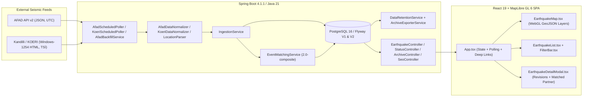

# Project Review & Structured Assessment: `deprem` (Türkiye Deprem İzleme Haritası)

## 1. Executive Summary & Architectural Overview

**`deprem`** is a full-stack seismic monitoring platform for Türkiye and its surrounding region, combining:
1. **Spring Boot 4.1.1 / Java 21 Backend** ([`build.gradle`](file:///C:/Users/LENOVO/IdeaProjects/deprem/build.gradle)): Ingests earthquake feeds from **AFAD** (JSON REST API) and **Boğaziçi University Kandilli Observatory / KOERI** (Windows-1254 HTML `<pre>` bulletin), normalizes and tracks immutable report revisions (`SourceReport` + `SourceReportRevision`), cross-matches AFAD and KOERI events (`EventMatchingService`), exports SHA-256-verified JSON archive shards before 30-day DB retention cleanup (`ArchiveExporterService` + `DataRetentionService`), and serves REST endpoints with ETag/Cache-Control headers.
2. **React 19 + TypeScript 6 + MapLibre GL 6 + Vite 8 Frontend** ([`frontend/package.json`](file:///C:/Users/LENOVO/IdeaProjects/deprem/frontend/package.json)): A zero-external-state-library SPA styled under the **"Sismik Radar / Güvenli Gözlemevi"** dark-mode design system ([`DESIGN.md`](file:///C:/Users/LENOVO/IdeaProjects/deprem/DESIGN.md)), building directly into Spring Boot's [`src/main/resources/static`](file:///C:/Users/LENOVO/IdeaProjects/deprem/frontend/vite.config.ts#L15-L18).
3. **Statistical Seismology Research Workbench** ([`research/`](file:///C:/Users/LENOVO/IdeaProjects/deprem/research/main.py)): Python scripts for historical AFAD catalog collection (`.parquet`), Magnitude of Completeness ($M_c$), Gutenberg-Richter $b$-value (Aki-Utsu MLE), and cumulative Benioff strain analysis.
4. **Zero-Budget Deployment & Ops Stack**: Docker multi-stage build ([`Dockerfile`](file:///C:/Users/LENOVO/IdeaProjects/deprem/Dockerfile)), Nginx + PostgreSQL 16 Compose stack ([`docker-compose.prod.yml`](file:///C:/Users/LENOVO/IdeaProjects/deprem/docker-compose.prod.yml)), Render Blueprint ([`render.yaml`](file:///C:/Users/LENOVO/IdeaProjects/deprem/render.yaml)), and GitHub Actions CI, keep-alive, and GPG-encrypted DB backup workflows ([`.github/workflows/`](file:///C:/Users/LENOVO/IdeaProjects/deprem/.github/workflows/ci.yml)).

> [!IMPORTANT]
> **Overall Assessment:** The project has a clear product philosophy ([`PRODUCT.md`](file:///C:/Users/LENOVO/IdeaProjects/deprem/PRODUCT.md)), thoughtful domain modeling (immutable revisions, SHA-256 payload/normalized hashes, Turkish `I/İ/ı` locale folding, environment-aware location parsing), and a high-contrast dark UI. However, **the transition from an AFAD-only MVP (`plan.md`) to a dual-source AFAD + Kandilli system (`KANDILLI_DATA_ACCESS.md` & `KANDILLI_MATCHING_IMPLEMENTATION_PLAN.md`) is half-finished**, leaving critical bugs in revision tracking, transaction safety, cross-source matching, SEO/canonical behavior, and deployment configuration.

---

## 2. Critical & High-Severity Findings (Must Fix)

### 2.1 Backend: Domain, Persistence & Concurrency

1. **KOERI Composite `sourceEventId` Breaks Revision Tracking When Time or Coordinates Change**
   - **Location:** [`KoeriDataNormalizer.java`](file:///C:/Users/LENOVO/IdeaProjects/deprem/src/main/java/com/ag/deprem/service/KoeriDataNormalizer.java#L63-L65)
   - **Problem:** Because KOERI rows do not include an event ID, `KoeriDataNormalizer` synthesizes `koeri-<yyyyMMddHHmmss>-<lat>-<lon>`. Whenever KOERI issues a revised solution (`Revize Edilmiş`) that shifts the origin time by even `1s` or the epicenter by `0.0001°`, a brand-new `sourceEventId` is generated. [`IngestionService.ingestReports`](file:///C:/Users/LENOVO/IdeaProjects/deprem/src/main/java/com/ag/deprem/service/IngestionService.java#L120-L149) then inserts a **second, duplicate `SourceReport`** instead of appending Revision #2 to the existing report—leaving both the preliminary (`İlksel`) and revised (`Revize Edilmiş`) earthquakes active on the map simultaneously.
   - **Plan Conflict:** Directly violates [`KANDILLI_DATA_ACCESS.md`](file:///C:/Users/LENOVO/IdeaProjects/deprem/KANDILLI_DATA_ACCESS.md#L75-L83).

2. **Spring `@Transactional` Rollback Trap in `IngestionService` -> `EventMatchingService`**
   - **Location:** [`IngestionService.java`](file:///C:/Users/LENOVO/IdeaProjects/deprem/src/main/java/com/ag/deprem/service/IngestionService.java#L141-L146), [`IngestionService.java`](file:///C:/Users/LENOVO/IdeaProjects/deprem/src/main/java/com/ag/deprem/service/IngestionService.java#L172-L177), and [`EventMatchingService.java`](file:///C:/Users/LENOVO/IdeaProjects/deprem/src/main/java/com/ag/deprem/service/EventMatchingService.java#L61)
   - **Problem:** `IngestionService.ingestReports` runs inside a `@Transactional` boundary and calls `matchingService.evaluateMatchesForReport` / `handleRevisionChange` inside a `try { ... } catch (Exception e)` block so matching failures won't block ingestion. However, `EventMatchingService` methods are annotated with `@Transactional` (default `Propagation.REQUIRED`), participating in the **same** physical transaction. If `EventMatchingService` throws any runtime/JPA exception, Spring marks the shared transaction `rollbackOnly = true` *before* the exception reaches `IngestionService`'s `catch` block, causing the outer commit to fail with `UnexpectedRollbackException` and rolling back the entire batch of ingested earthquakes.
   - **Fix:** Use `@Transactional(propagation = Propagation.REQUIRES_NEW)` on the matching entrypoints (or invoke matching after the ingestion transaction commits).

3. **TOCTOU Race Conditions & Missing Database Uniqueness Constraint on `event_match`**
   - **Location:** [`V1__initial_schema.sql`](file:///C:/Users/LENOVO/IdeaProjects/deprem/src/main/resources/db/migration/V1__initial_schema.sql#L44-L60), [`V2__kandilli_and_event_grouping.sql`](file:///C:/Users/LENOVO/IdeaProjects/deprem/src/main/resources/db/migration/V2__kandilli_and_event_grouping.sql#L10-L49), [`EventMatchingService.java`](file:///C:/Users/LENOVO/IdeaProjects/deprem/src/main/java/com/ag/deprem/service/EventMatchingService.java#L189-L214), [`AfadScheduledPoller.java`](file:///C:/Users/LENOVO/IdeaProjects/deprem/src/main/java/com/ag/deprem/service/AfadScheduledPoller.java#L33-L45)
   - **Problem:**
     - Neither `V1` nor `V2` migration defines a `UNIQUE (left_report_id, right_report_id)` or `CHECK (left_report_id <> right_report_id)` constraint on `event_match` (only a non-unique index `idx_match_reports`). When `AfadScheduledPoller` and `KoeriScheduledPoller` run concurrently, both threads can evaluate the same AFAD–KOERI pair simultaneously, see `Optional.empty()` from `findMatchBetweenReports`, and insert duplicate `EventMatch` rows.
     - `AfadScheduledPoller` lacks the `AtomicBoolean isPolling` single-flight guard present in [`KoeriScheduledPoller.java`](file:///C:/Users/LENOVO/IdeaProjects/deprem/src/main/java/com/ag/deprem/service/KoeriScheduledPoller.java#L22), and can also collide concurrently with [`AfadBackfillService.java`](file:///C:/Users/LENOVO/IdeaProjects/deprem/src/main/java/com/ag/deprem/service/AfadBackfillService.java#L38-L90).

4. **`EventMatchingService` Violates Core Matching Rules from `KANDILLI_MATCHING_IMPLEMENTATION_PLAN.md`**
   - **Location:** [`EventMatchingService.java`](file:///C:/Users/LENOVO/IdeaProjects/deprem/src/main/java/com/ag/deprem/service/EventMatchingService.java#L96-L280)
   - **Problems:**
     - **Incompatible Magnitude Scales Compared Directly (Lines 96–99, 166–167, 274–280):** Computes `Math.abs(currentRev.getMagnitudeValue() - otherRev.getMagnitudeValue())` without checking if `magnitudeType` matches (e.g., comparing KOERI `MD` or `ML` directly against AFAD `Mw`), contradicting [`KANDILLI_MATCHING_IMPLEMENTATION_PLAN.md`](file:///C:/Users/LENOVO/IdeaProjects/deprem/KANDILLI_MATCHING_IMPLEMENTATION_PLAN.md#L72).
     - **Overwrites Manual Decisions (Lines 189–213):** `saveOrUpdateMatch` unconditionally overwrites `status` and sets `decisionType = "AUTO"`, even if an existing match had `MANUAL_MATCHED` or `REJECTED` status (violating [`KANDILLI_MATCHING_IMPLEMENTATION_PLAN.md`](file:///C:/Users/LENOVO/IdeaProjects/deprem/KANDILLI_MATCHING_IMPLEMENTATION_PLAN.md#L94-L99)).
     - **`EventGroup` Orphaning & Unused Grouping Tables (Lines 216–269):** When a revision change marks a match `SUPERSEDED` (Line 262), the previously linked `EventGroupMember` rows are never removed. Moreover, `EventGroup` and `EventGroupMember` are written on every `AUTO_MATCHED` pair, but **`EarthquakeQueryService` never reads them**—meaning `GET /api/v1/earthquakes` always returns duplicate ungrouped rows for every matched earthquake (one AFAD card and one KOERI card in the UI).

5. **30-Day Data Retention Destroys `EventMatch` History & Leaves Orphaned `EventGroup` Rows**
   - **Location:** [`DataRetentionService.java`](file:///C:/Users/LENOVO/IdeaProjects/deprem/src/main/java/com/ag/deprem/service/DataRetentionService.java#L94), [`ArchiveExporterService.java`](file:///C:/Users/LENOVO/IdeaProjects/deprem/src/main/java/com/ag/deprem/service/ArchiveExporterService.java#L65-L79), [`V1__initial_schema.sql`](file:///C:/Users/LENOVO/IdeaProjects/deprem/src/main/resources/db/migration/V1__initial_schema.sql#L46-L47)
   - **Problem:** `DataRetentionService` deletes `SourceReport` rows older than 30 days after exporting `SourceReportRevision` shards. Because `event_match` and `event_group_member` have `ON DELETE CASCADE` on `source_report(id)` and `ArchiveExporterService` does not export matches or groups, all cross-source match records are permanently lost after 30 days, and empty `event_group` rows are left orphaned in PostgreSQL.

6. **Host Header Injection / Cache Poisoning in `SeoController` & Hardcoded Domain Ignore**
   - **Location:** [`SeoController.java`](file:///C:/Users/LENOVO/IdeaProjects/deprem/src/main/java/com/ag/deprem/controller/SeoController.java#L116-L143)
   - **Problem:**
     - When `app.site.base-url` is unset (the default in [`application.properties`](file:///C:/Users/LENOVO/IdeaProjects/deprem/src/main/resources/application.properties#L56)), `resolveBaseUrl` trusts raw `X-Forwarded-Host` and `X-Forwarded-Proto` headers without validation or XML escaping, interpolating them into `/sitemap.xml` (`Cache-Control: public, max-age=3600`) and `/robots.txt` (`max-age=86400`).
     - Line 117 (`if (baseUrl != null && !baseUrl.isBlank() && !baseUrl.contains("depremizleme.com"))`) explicitly ignores `app.site.base-url` if the operator uses `depremizleme.com`—which is the default example domain in [`.env.example`](file:///C:/Users/LENOVO/IdeaProjects/deprem/.env.example#L6) and [`DEPLOYMENT_PLAYBOOK.md`](file:///C:/Users/LENOVO/IdeaProjects/deprem/DEPLOYMENT_PLAYBOOK.md#L27)!

7. **KOERI Poller Uses Plaintext HTTP & Records Success Before Parsing**
   - **Location:** [`application.properties`](file:///C:/Users/LENOVO/IdeaProjects/deprem/src/main/resources/application.properties#L61), [`KoeriApiClient.java`](file:///C:/Users/LENOVO/IdeaProjects/deprem/src/main/java/com/ag/deprem/service/KoeriApiClient.java#L32-L70), [`KoeriScheduledPoller.java`](file:///C:/Users/LENOVO/IdeaProjects/deprem/src/main/java/com/ag/deprem/service/KoeriScheduledPoller.java#L39-L45)
   - **Problem:** Default URL is `http://www.koeri.boun.edu.tr/scripts/lst0.asp` (unencrypted HTTP instead of `https://`), and `KoeriApiClient.fetchRawPage()` calls `statusTracker.recordSuccess("KOERI", now)` immediately on HTTP 200 before `KoeriPageParser.parse(pageContent)` runs. If KOERI serves an HTML error page that parses to `0` events, `/api/v1/status` still reports KOERI as `"current"` and healthy.

---

### 2.2 Frontend: Accessibility, State Management, SEO & UX

1. **Broken Keyboard Navigation on Earthquake List Cards (WCAG 2.1.1 & `DESIGN.md` Violation)**
   - **Location:** [`EarthquakeList.tsx`](file:///C:/Users/LENOVO/IdeaProjects/deprem/frontend/src/components/EarthquakeList.tsx#L141-L146), [`App.css`](file:///C:/Users/LENOVO/IdeaProjects/deprem/frontend/src/App.css#L524-L536)
   - **Problem:** To fix an earlier critique about nested `<button>` elements, the outer card in `EarthquakeList.tsx` was changed to `<article className="earthquake-card" onClick={() => onSelect(item)}>`—but **`tabIndex={0}` and `onKeyDown` (`Enter`/`Space`) were removed**. Keyboard users cannot focus earthquake cards to highlight them on the map, rendering `.earthquake-card:focus-visible` dead CSS and violating [`DESIGN.md`](file:///C:/Users/LENOVO/IdeaProjects/deprem/DESIGN.md#L165).

2. **`useSeo.ts` Directly Violates `SEO_IMPLEMENTATION.md` & Produces Broken Province Canonical URLs**
   - **Location:** [`useSeo.ts`](file:///C:/Users/LENOVO/IdeaProjects/deprem/frontend/src/hooks/useSeo.ts#L13-L137) vs. [`SEO_IMPLEMENTATION.md`](file:///C:/Users/LENOVO/IdeaProjects/deprem/SEO_IMPLEMENTATION.md#L39-L76)
   - **Problems:**
     - **Mutates Canonical URL on Item Selection (Lines 20–27):** Clicking any earthquake on the map/list changes `<link rel="canonical">` and `og:url` to `/?event=<id>`, explicitly forbidden by `SEO_IMPLEMENTATION.md` (*"The canonical URL must represent the homepage, not the current event query"*).
     - **Invalid Turkish Characters in Province Canonical URL (Line 31):** Uses `encodeURIComponent(provinceName.toLowerCase())` (producing `/son-depremler/i%CC%87stanbul` or `/son-depremler/%C3%A7anakkale`) instead of `activeProvince.slug` (`/son-depremler/istanbul`, `/son-depremler/canakkale`).
     - **Misleading Schema.org Structured Data (Lines 74–94):** Injects a second JSON-LD block claiming `@type: 'SpecialAnnouncement'` with `category: 'https://schema.org/GovernmentService'` and `creator: 'AFAD'`, contradicting the non-affiliation rules in `PRODUCT.md` and `SEO_IMPLEMENTATION.md`.

3. **Missing / Mismatched CSS Classes Across `InfoModal`, `EarthquakeList`, and `EarthquakeDetailModal`**
   - **Location:**
     - [`InfoModal.tsx`](file:///C:/Users/LENOVO/IdeaProjects/deprem/frontend/src/components/InfoModal.tsx#L86): Uses `className="btn-close-modal"`, whereas [`App.css`](file:///C:/Users/LENOVO/IdeaProjects/deprem/frontend/src/App.css#L641) defines `.btn-modal-close`. The close button (`✕`) renders as an unstyled default browser button.
     - [`EarthquakeList.tsx`](file:///C:/Users/LENOVO/IdeaProjects/deprem/frontend/src/components/EarthquakeList.tsx#L165-L210): Uses `.card-details`, `.detail-dot`, `.detail-item`, and `.list-load-more`, whereas `App.css` defines `.card-specs` ([`App.css:541`](file:///C:/Users/LENOVO/IdeaProjects/deprem/frontend/src/App.css#L541)) and `.list-load-more-container` ([`App.css:626`](file:///C:/Users/LENOVO/IdeaProjects/deprem/frontend/src/App.css#L626)).
     - [`App.css`](file:///C:/Users/LENOVO/IdeaProjects/deprem/frontend/src/App.css#L891): References `animation: fadeIn 0.15s ease;` on `.info-tab-panel`, but `@keyframes fadeIn` is never defined.

4. **Filter Bar Bug (`M ≥ 4.5` Missing Option) & Desynchronized Province Routing**
   - **Location:** [`FilterBar.tsx`](file:///C:/Users/LENOVO/IdeaProjects/deprem/frontend/src/components/FilterBar.tsx#L74-L77), [`FilterBar.tsx`](file:///C:/Users/LENOVO/IdeaProjects/deprem/frontend/src/components/FilterBar.tsx#L136-L143), [`App.tsx`](file:///C:/Users/LENOVO/IdeaProjects/deprem/frontend/src/App.tsx#L24-L37), [`App.tsx`](file:///C:/Users/LENOVO/IdeaProjects/deprem/frontend/src/App.tsx#L244-L258)
   - **Problems:**
     - Clicking the **"Belirgin (M ≥ 4.5)"** quick chip sets `minMagnitude: 4.5`, but the `<select id="min-magnitude-select">` only has options for `""`, `2.0`, `3.0`, `3.5`, `4.0`, `5.0`—causing the dropdown to go blank when `4.5` is active.
     - Visiting `/son-depremler/izmir` sets `activeProvince` to İzmir, but never flies/centers `EarthquakeMap` onto `activeProvince.lat`/`lng`/`zoom` from [`provinces.ts`](file:///C:/Users/LENOVO/IdeaProjects/deprem/frontend/src/data/provinces.ts#L10-L92). Furthermore, changing the place filter from `"İzmir"` to `"Ankara"` does not update or clear `activeProvince`, so `AiSummarySnippet` and `useSeo` continue displaying `"İzmir"` for Ankara's data.

5. **Race Conditions in `refreshData`, `handleLoadMore`, and `EarthquakeDetailModal`**
   - **Location:** [`App.tsx`](file:///C:/Users/LENOVO/IdeaProjects/deprem/frontend/src/App.tsx#L178-L242), [`EarthquakeDetailModal.tsx`](file:///C:/Users/LENOVO/IdeaProjects/deprem/frontend/src/components/EarthquakeDetailModal.tsx#L23), [`EarthquakeDetailModal.tsx`](file:///C:/Users/LENOVO/IdeaProjects/deprem/frontend/src/components/EarthquakeDetailModal.tsx#L72-L84)
   - **Problems:**
     - `refreshData` creates an `AbortController` (Line 179) that is never stored or aborted on subsequent refreshes.
     - `handleLoadMore` does not check `activeRequestIdRef` or abort if filters change while pagination is in flight.
     - `EarthquakeDetailModal` does not reset `setDetail(null)` when `item.id` changes (Line 74), briefly displaying the previous earthquake's `detail.current` until the new network request resolves.

6. **False Offline Caching Claims in UI & Service Worker Bug**
   - **Location:** [`sw.js`](file:///C:/Users/LENOVO/IdeaProjects/deprem/frontend/public/sw.js#L50-L80), [`App.tsx`](file:///C:/Users/LENOVO/IdeaProjects/deprem/frontend/src/App.tsx#L284-L289), [`InfoModal.tsx`](file:///C:/Users/LENOVO/IdeaProjects/deprem/frontend/src/components/InfoModal.tsx#L154-L156)
   - **Problem:** `sw.js` explicitly bypasses caching for `/api/*` and the app never stores earthquake lists in `localStorage`/`IndexedDB`. Yet the offline banner (`App.tsx:287`), `index.html:97`, and `InfoModal.tsx:155` tell users that recent earthquakes are cached on their device for offline viewing. Additionally, `sw.js:60` uses Network-First for navigation requests (`request.mode === 'navigate'`) without updating `/index.html` in `caches.open(CACHE_NAME)`, so offline navigation serves a stale `index.html` from install time whose hashed JS asset filenames may no longer match cached chunks.

---

### 2.3 DevOps, Deployment, Research Workbench & Repository Hygiene

1. **Shared Rate-Limit Bucket Behind Cloudflare (`30r/s` for All Users Combined)**
   - **Location:** [`nginx/nginx.conf`](file:///C:/Users/LENOVO/IdeaProjects/deprem/nginx/nginx.conf#L45) & [`DEPLOYMENT_PLAYBOOK.md`](file:///C:/Users/LENOVO/IdeaProjects/deprem/DEPLOYMENT_PLAYBOOK.md#L23-L36)
   - **Problem:** `nginx.conf` defines `limit_req_zone $binary_remote_addr zone=api_rate_limit:10m rate=30r/s;` without configuring `real_ip_header CF-Connecting-IP;` and Cloudflare's IP ranges (`set_real_ip_from`). When deployed behind Cloudflare as instructed in `DEPLOYMENT_PLAYBOOK.md`, `$binary_remote_addr` is Cloudflare's proxy IP—meaning **all visitors sharing a Cloudflare edge PoP share a single 30 req/s limit**, triggering widespread HTTP 429 errors during an earthquake traffic spike.

2. **Ephemeral Archive Storage in Docker & Render + Stale Frontend Assets in `Dockerfile`**
   - **Location:** [`Dockerfile`](file:///C:/Users/LENOVO/IdeaProjects/deprem/Dockerfile#L1-L42), [`docker-compose.prod.yml`](file:///C:/Users/LENOVO/IdeaProjects/deprem/docker-compose.prod.yml#L26-L53), [`render.yaml`](file:///C:/Users/LENOVO/IdeaProjects/deprem/render.yaml#L1-L22)
   - **Problems:**
     - `DataRetentionService` exports `.json` archive shards to `./archive` before deleting 30-day-old DB rows, but neither `docker-compose.prod.yml` nor `render.yaml` mounts a persistent volume at `/app/archive`. Container restarts permanently destroy exported archives while the DB rows are already deleted!
     - `Dockerfile` only builds the Gradle backend (`eclipse-temurin:21-jdk-alpine`) and never runs `npm ci && npm run build` in `frontend/`. It relies entirely on developers manually building `frontend/` and committing `src/main/resources/static/` to Git.

3. **Why `graphify-out` Was Polluted & Blanket `*.md` Ignore in `.gitignore`**
   - **Location:** [`frontend/vite.config.ts`](file:///C:/Users/LENOVO/IdeaProjects/deprem/frontend/vite.config.ts#L15-L18), [`.gitignore`](file:///C:/Users/LENOVO/IdeaProjects/deprem/.gitignore#L2-L39), [`graphify-out/GRAPH_REPORT.md`](file:///C:/Users/LENOVO/IdeaProjects/deprem/graphify-out/GRAPH_REPORT.md#L1-L340)
   - **Problems:**
     - Because Vite outputs minified bundles (`maplibre-gl-worker-DxGNRm0a.mjs` and `index-DhEsqNT9.js`) directly into `src/main/resources/static/assets/`, Graphify AST-indexed the minified third-party bundles, inflating the graph to **5,981 nodes and 20,578 edges** where ~95% of communities and all top God Nodes (`push()`, `constructor()`, `n()`, `i()`, `r()`) are mangled MapLibre GL / React internals.
     - `.gitignore` Lines 2–3 contain `*.md` and `**/*.md`, blanket-ignoring all Markdown documentation across the repository unless force-added.

4. **Statistical Bugs in the Python Research Workbench (`research/`)**
   - **Location:** [`research/src/data_collector.py`](file:///C:/Users/LENOVO/IdeaProjects/deprem/research/src/data_collector.py#L19-L45), [`research/src/seismology_metrics.py`](file:///C:/Users/LENOVO/IdeaProjects/deprem/research/src/seismology_metrics.py#L19-L61)
   - **Problems:**
     - **Benioff Strain Bug (`seismology_metrics.py:59–61`):** `valid = np.nan_to_num(magnitudes, nan=0.0)` followed by `10.0 ** (0.75 * valid)` adds $10^0 = 1.0$ unit of strain for every `NaN` magnitude instead of `0.0`.
     - **Division-by-Zero Risk in `calculate_b_value_mle` (`seismology_metrics.py:46`):** Does not guard against `mean_m <= mc - bin_width / 2.0` when `len(valid) < 20` triggers the hardcoded fallback `mc = 1.5`.
     - **10–15 Day Fetch Window Risk (`data_collector.py:41`, `main.py:27`):** Queries AFAD in 10–15 day chunks without pagination or `limit` parameters, risking silent truncation during major aftershock sequences (unlike the Java `AfadBackfillService` which uses 24h windows).

---

## 3. Prioritized Action Plan

| Priority | Track | Recommended Action |
|---|---|---|
| **P0** | **Backend Data Integrity** | Fix `KoeriDataNormalizer` identity resolution (match against existing recent KOERI reports within a tight spatio-temporal window before minting a new `sourceEventId`), isolate `EventMatchingService` in `Propagation.REQUIRES_NEW` (or post-commit), and add a Flyway `V3` migration adding `UNIQUE(left_report_id, right_report_id)` and `CHECK (left_report_id <> right_report_id)` on `event_match`. |
| **P0** | **Matching & Retention** | Guard `EventMatchingService.saveOrUpdateMatch` from overwriting `MANUAL_MATCHED`/`REJECTED`, restrict magnitude delta scoring to compatible magnitude types, and change `event_match` / `event_group_member` foreign keys or `DataRetentionService` so 30-day cleanup does not silently erase match history. |
| **P1** | **Frontend Accessibility & UX** | Restore `tabIndex={0}` and `onKeyDown` (`Enter`/`Space`) on `<article className="earthquake-card">`, fix mismatched CSS class names (`.btn-modal-close`, `.card-specs`, `.list-load-more-container`), add `<option value="4.5">M ≥ 4.5</option>` to `FilterBar.tsx`, and add a Source filter (`ALL` / `AFAD` / `KOERI`) in `FilterBar.tsx`. |
| **P1** | **SEO & Security** | Remove `X-Forwarded-Host` cache-poisoning vector and the hardcoded `!baseUrl.contains("depremizleme.com")` bug in `SeoController.java`; fix `useSeo.ts` so clicking an event does not overwrite `<link rel="canonical">`, use `activeProvince.slug` for province URLs, and remove the `GovernmentService` JSON-LD claim. |
| **P1** | **DevOps & Build Pipeline** | Add a Node 22 frontend build stage to `Dockerfile`, mount a persistent volume for `/app/archive` in `docker-compose.prod.yml`, configure Cloudflare `real_ip_header CF-Connecting-IP` in `nginx.conf`, add `npm run lint` to `.github/workflows/ci.yml`, and remove `src/main/resources/static/` from Git (or exclude it from Graphify). |
| **P2** | **Research Workbench** | Fix `calculate_benioff_strain` for `NaN` values, guard `calculate_b_value_mle` denominator, and reduce `data_collector.py` chunk size from 15 days to 1–2 days. |
