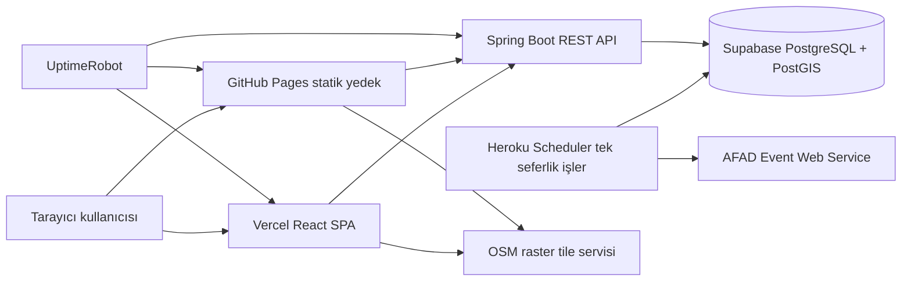
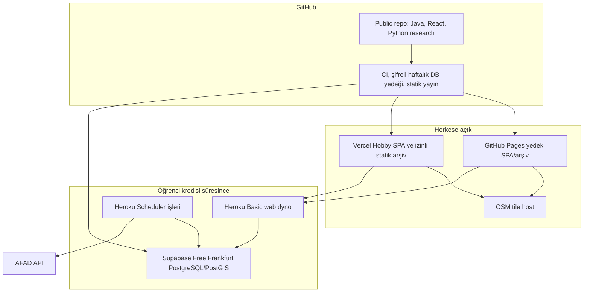

# Türkiye Deprem İzleme Haritası — Yazılım Tasarım ve Uygulama Planı

## 1. Yönetici özeti

Bu proje, Türkiye ve yakın çevresindeki depremleri güvenilir kaynaklardan alıp kullanıcıya Türkçe, etkileşimli bir harita ve olay listesiyle sunan, kamuya açık ve ticari olmayan bir izleme uygulamasıdır. İlk sürümün odağı deprem verisini doğru göstermek, kaynak ve güncellik bilgisini görünür kılmak, olayları harita ve liste üzerinden inceletmektir.

Plan üç evreye ayrılır:

1. **İzleme MVP’si:** AFAD verisinin alınması, normalleştirilmesi, sürümlenmesi, REST API üzerinden sunulması ve haritada gösterilmesi.
2. **Ücretsiz altyapıda devamlılık:** Heroku öğrenci kredisi kullanılırken canlı API; kredi bitince yalnızca izin verilmiş arşiv için Vercel ana statik yayını ve ayrı URL’de GitHub Pages yedeği. AFAD statik arşiv yayını için yazılı kullanım açıklaması alınamazsa siteler arşiv verisi sunmak yerine AFAD’a bağlantı veren bilgi sayfasına dönüşür.
3. **Ayrı araştırma evresi:** Uygulamaya entegre olmayan, AFAD kataloğunun kalitesini ve istatistiksel özelliklerini inceleyen Python araştırma alanı. Sonuçlar tahmin veya resmî uyarı olarak sunulmaz.

Uygulama deprem tahmini, uyarı aboneliği, kullanıcı hesabı veya kişisel bilgi toplama sağlamaz. Olay zamanı ile uygulamanın veriyi aldığı zaman ayrı tutulur. Kaynak erişilemez olduğunda son doğrulanmış kayıtların zamanı ve durumu açıkça gösterilir. Boş harita “deprem olmadı” anlamına gelecek biçimde sunulmaz.

**Temel sınırlar:** Aylık nakit altyapı bütçesi 0 USD’dir. Öğrenci kredileri ve ücretsiz planlar kalıcı kapasite veya çalışma süresi garantisi değildir. Projenin resmi uyarı hizmeti olmadığı arayüzde belirtilir; kullanıcılar güncel resmî bilgi için AFAD’a yönlendirilir.

## 2. Problem, kullanıcılar ve hedefler

### 2.1 Problem

Deprem bilgileri kaynakların kendi arayüzlerinde yer alır; kaynaklar farklı format, büyüklük türü ve revizyon davranışları gösterebilir. Kaynak verisini tek biçime dönüştürmeden doğrudan haritaya bağlamak; yinelenen olay, belirsiz zaman, kaynaklar arası büyüklük farkı ve güncel olmayan bilgi sorunları doğurabilir.

Projenin amacı bilimsel bir tahmin üretmek değil, kaynak kayıtlarının kökenini ve güncelliğini koruyarak onları daha kolay incelemeyi sağlamaktır.

### 2.2 Hedef kullanıcılar

- Son depremleri harita ve listede incelemek isteyen Türkçe konuşan genel kullanıcılar.
- Olayları zaman, büyüklük, derinlik ve konuma göre daraltmak isteyen kullanıcılar.
- Projeyi geliştiren kişi ve ileride, yalnızca veri uygun bulunursa, çevrimdışı katalog araştırması yapacak araştırmacı.

MVP’de kullanıcı hesabı, kişiselleştirme, uyarı aboneliği veya kullanıcı verisi toplama yoktur.

### 2.3 Ölçülebilir ürün hedefleri

- AFAD’ın erişilebilir kataloğundan gelen geçerli zaman ve koordinata sahip olayları göstermek.
- AFAD verisini normalleştirirken özgün kaynak kimliğini, büyüklük türünü ve revizyon geçmişini korumak.
- Kaynağın son başarılı alınma zamanını ve veri gecikmesini her zaman kullanıcıya göstermek.
- Görünür tarayıcı sekmesinde arayüzü beş dakikada bir güncellemek; sekme arka plandayken istemci sorgularını durdurmak.
- Kullanıcının son 24 saati varsayılan olarak görmesini, daha eski zaman aralıklarında uygun statik arşiv dilimlerini yükleyebilmesini sağlamak.
- Ücretsiz hizmet sınırlarında ücretli kullanıma geçmeden açık hata veya salt okunur davranış sergilemek.
- Deprem tahmini veya resmî uyarı verildiği izlenimini oluşturmamak.

## 3. Gereksinimler ve kabul ölçütleri

Öncelik sınıfları: **P0** yayın için gerekli, **P1** MVP’de hedef, **P2** sonraki geliştirme.

| Kimlik | Gereksinim | Öncelik | Kabul ölçütü |
|---|---|---:|---|
| FR-001 | AFAD olay verisini periyodik al | P0 | Sağlıklı kaynakta yeni kayıtlar hedeflenen 10 dakika iş döngüsünde alınır; yinelenen işler yinelenen kayıt üretmez. |
| FR-002 | Kaynak kayıtlarını doğrula ve normalleştir | P0 | Geçerli zaman ve koordinat varsa eksik büyüklük, derinlik veya yer adı olayın görünmesini engellemez; eksik alan açıkça belirtilir. |
| FR-003 | Kaynak kimliği ve kayıt revizyonlarını sakla | P0 | Aynı AFAD kimliği yeni değerlerle gelirse yeni revizyon eklenir; önceki değerler kaybolmaz. |
| FR-004 | Olayları harita ve listede göster | P0 | Aynı filtre ve zaman aralığı için harita ve liste aynı olay kümesini yansıtır. |
| FR-005 | Olay ayrıntısını ve kaynak raporlarını göster | P0 | Detay ekranı kaynak, kaynak kimliği, rapor zamanı, alınma zamanı, büyüklük türü, koordinat, derinlik ve varsa güncelleme durumunu ayırt eder. |
| FR-006 | Zaman, büyüklük, derinlik, alan ve yer adına göre filtrele | P1 | Filtreler harita ve listeye aynı anda uygulanır; sıfır sonuç durumu açıkça gösterilir. |
| FR-007 | Güncellik ve kaynak sağlığını göster | P0 | Son başarılı alma zamanı, kaynak durumu ve katalog kapsamı `/status` üzerinden sağlanır ve arayüzde görünür. |
| FR-008 | AFAD kaynağı kesildiğinde son doğrulanmış veriyi göster | P0 | API erişilebilir ve veritabanı çalışır durumdaysa son kayıtlar korunur; kaynak gecikmesi banner ve kaynak zamanıyla açıklanır. |
| FR-009 | Tarihsel statik arşivi yükle | P1 | AFAD yeniden yayımlama açıklaması alınmışsa tarih aralığı seçildiğinde yalnız ilgili arşiv dilimi yüklenir; kapsam ve arşiv zamanı gösterilir. |
| FR-010 | Kredi bitişinde arşiv modu | P0 | İzinli statik arşiv varsa iki statik yayın aynı arşiv içeriğini sunar; izin yoksa siteler AFAD’a bağlantı veren bilgi sayfasına dönüşür. |
| FR-011 | Erişilebilir liste alternatifi ve klavye kullanımı | P0 | Harita kullanılamasa da olay listesi ve ayrıntı klavye ile kullanılabilir; temel akışlar ekran okuyucuyla anlaşılır. |
| NFR-001 | Güncellik durumunu açık belirt | P0 | Veri 20 dakikadan eskiyse “gecikmeli”, 60 dakikadan eskiyse belirgin “eski veri” durumu gösterilir. |
| NFR-002 | Veri kaynağını ve zamanları ayır | P0 | Olay oluş zamanı ile uygulamanın son alma zamanı farklı alanlardadır; arayüzde karıştırılmaz. |
| NFR-003 | Coğrafi tutarlılık | P0 | Koordinat sırası WGS84 GeoJSON standardına göre boylam/enlem olarak işlenir; bozuk veya aralık dışı koordinatlar haritaya gönderilmez. |
| NFR-004 | Ücretsiz planlarda güvenli çalışma | P0 | Ücretsiz kota yaklaşımı görünür izlenir; kota aşımı ücretli kullanıma dönüşmez; servis duraklaması kullanıcıya “veri yok” diye sunulmaz. |
| NFR-005 | Erişilebilirlik | P1 | Tasarım WCAG 2.2 AA hedefler; renk tek başına büyüklük veya derinlik kodlamaz. |
| NFR-006 | Ölçek varsayımı | P1 | Normal yük hedefi 100–1.000 ziyaretçi/gündür; eşzamanlı kullanıcı veya uptime garantisi verilmez. Ani yükte cache, eski veri durumu ve kontrollü hata akışı çalışır. |
| NFR-007 | Güvenlik | P0 | Yazma yolları yalnız backend ve güvenli iş süreçleriyle sınırlıdır; herkese açık API salt okunur, giriş gerektirmez ve sınırlandırılır. |
| NFR-008 | Arşiv bütünlüğü | P0 | DB’den eski veri silinmeden önce arşiv parçası iki hedefe yayımlanır, kayıt sayısı ve checksum doğrulanır. |

## 4. Kapsam ve evreler

### 4.1 MVP kapsamı

- Türkiye sınırından 250 km çevre alanı.
- AFAD canlı birincil kaynak; Kandilli otomatik alınması ancak yazılı erişim ve kullanım doğrulaması sonrasında.
- 24 saat varsayılan görünüm, en yeni olay önce.
- MapLibre GL JS ve OSM raster döşemeleri.
- Olay listesi, harita, ayrıntı paneli ve zaman/büyüklük/derinlik/alan/yer filtresi.
- AFAD rapor değerleri ve büyüklük türlerinin aynen korunması.
- Kaynak, güncellik, gecikme, boş alan ve revizyon bilgisinin görünür olması.
- Modüler Spring Boot API, PostgreSQL/PostGIS ve dönemsel ingest/backfill işleri.
- Türkçe arayüz, klavye erişimi ve harita dışı liste alternatifi.
- Ücretsiz plan panoları ve UptimeRobot ile temel erişilebilirlik izlemesi.

### 4.2 MVP dışında

- Deprem tahmini, olasılık skoru veya model kaynaklı uyarı.
- SMS, e-posta, push uyarısı veya abonelik.
- Üyelik, rol yönetimi ve kişiselleştirme.
- Çevrimdışı harita döşemeleri, harita döşemesi toplu indirme veya kendi OSM tile sunucusu.
- AFAD’dan yazılı kullanım açıklaması alınmadan herkese açık tarihsel AFAD statik arşivi.
- Kandilli verisini izinsiz veya koşulları doğrulanmadan otomatik çekme.
- Büyük waveform dosyaları ya da derin öğrenme/GPU altyapısı.

### 4.3 Sonraki evreler

1. AFAD canlı izleme.
2. Veri kapsamı ve arşiv boyutu doğrulaması; izin varsa statik arşiv ve DB boşaltma.
3. UI ve API yük/erişilebilirlik iyileştirmeleri.
4. Ayrı Python araştırma alanında AFAD katalog kalite incelemesi.
5. Araştırma sonuçlarını insan incelemesinden sonra yayımlama; ham kayıtlar ancak kullanım koşulları izin verirse.

## 5. Teknoloji seçimi ve gerekçe

| Alan | Seçim | Gerekçe ve sınırlar |
|---|---|---|
| Backend | Java 21, Spring Boot mevcut iskelet sürüm çizgisi | Kullanıcının Java/Spring deneyimi ve mevcut repo ile uyum. Mevcut iskelet yalnız WebMVC içeriyor; sağlık kontrolü, PostGIS ve güvenlik yapılandırması ayrıca eklenmeli. Bağımlılık sürümleri uygulama başlangıcında resmî uyumluluk matrisiyle doğrulanmalı. |
| Mimari | Modüler monolit | REST API, sağlayıcı adaptörleri, normalleştirme/eşleştirme, arşivleme ve gözlemlenebilirlik aynı uygulama alanında ayrılır. Mikroservis ve mesaj kuyruğu ilk sürümde gereksiz operasyonel yük olur. |
| Veri tabanı | PostgreSQL + PostGIS, Supabase Free | Coğrafi filtre ve mekânsal indeksleme için uygun. Frankfurt bölgesi seçilir. Free DB, 500 MB veritabanı boyutunu aşınca salt okunur moda geçebilir; otomatik yedekleme Free planda yoktur. [Supabase DB boyutu](https://supabase.com/docs/guides/platform/database-size), [PostGIS](https://supabase.com/docs/guides/database/extensions/postgis), [bölge listesi](https://supabase.com/docs/guides/platform/regions). |
| Web uygulaması | React + TypeScript SPA | Harita/listenin aynı durum modelini paylaşmasını ve statik dağıtımı kolaylaştırır. |
| Harita | MapLibre GL JS | Açık kaynaklı WebGL tabanlı harita istemcisi. [Resmî MapLibre belgeleri](https://maplibre.org/maplibre-gl-js/docs/). |
| Döşeme kaynağı | OSM standard raster tile servisi | Sıfır başlangıç maliyeti; en iyi çaba hizmetidir ve SLA sağlamaz. Görünür atıf gerekir; cache yönergeleri izlenmeli; ön yükleme/toplu indirme ve çevrimdışı kullanım yapılmamalı. [OSM tile politikası](https://operations.osmfoundation.org/policies/tiles/), [atıf yönergeleri](https://osmfoundation.org/wiki/Attribution_Guidelines). |
| API | REST/JSON, `/api/v1` | Tarayıcı ve statik arşivle sade uyum. React güncel sayfayı GeoJSON’a çevirir; backend API GeoJSON sunmak zorunda değildir. |
| Hosting | Heroku öğrenci kredisi; Vercel Hobby; GitHub Pages yedeği | Öğrenci kredisi süresi ve ücretsiz limitler değişebilir; bu nedenle kalıcı ücretsiz backend varsayılmaz. Vercel Hobby ticari olmayan kişisel projelere yöneliktir; ücretsiz kotada projeler duraklatılabilir. GitHub Pages 1 GB yayın boyutu ve 100 GB/ay esnek bant genişliği sınırı bildirir. [GitHub Education Pack](https://education.github.com/pack/), [Vercel Hobby](https://vercel.com/docs/plans/hobby), [Vercel limitleri](https://vercel.com/docs/limits), [GitHub Pages limitleri](https://docs.github.com/en/pages/getting-started-with-github-pages/github-pages-limits). |
| Araştırma | Uygulamadan ayrı Python projesi, aynı repo altında `research/` | Python yerel olarak kurulu; ayrı bağımlılık ortamı ve CI ile Java uygulama dağıtımını kirletmez. Notebook keşfi gerektiğinde kullanılabilir; doğrulanan çalışmalar tekrarlanabilir script ve rapor haline getirilir. |
| İzleme | UptimeRobot Free + platform panoları | Vercel, GitHub Pages ve API sağlık uçları 5 dakikada kontrol edilebilir; ücretsiz planda 50 monitor vardır. SLA garantisi değildir. [UptimeRobot Free](https://uptimerobot.com/pricing/). |

### 5.1 Mevcut repo durumu

Depoda Java 21 araç zinciri, Spring Boot 4.1.1 ve temel WebMVC test altyapısı bulunan küçük bir iskelet vardır. Frontend, veri katmanı, PostGIS, izleme veya gerçek deprem iş mantığı henüz mevcut değildir. Planlama aşamasında repo değiştirilmemiştir.

## 6. Sistem mimarisi

### 6.1 Bağlam diyagramı



API ve Supabase çalışır durumdayken iki statik arayüz de aynı canlı API’ye bağlanır. Heroku kredisi sona erince, izinli arşiv varsa Vercel ve GitHub Pages arşiv dosyalarını sunar. GitHub Pages ayrı adrestir; otomatik URL devri yoktur. Her iki sağlayıcının kotaları veya erişimi aşılırsa hizmet garantisi verilmez.

### 6.2 Bileşen sorumlulukları

| Bileşen | Girdi → çıktı | Arıza şekli ve sınır |
|---|---|---|
| AFAD adapter | AFAD JSON → kaynak raporu | Timeout, hatalı JSON, alan değişimi; retry ve circuit breaker kullanır, ham gövdeyi kısa süre saklar. |
| Ingestion job | Son 24 saat ve periyodik tarama → yeni/değişmiş rapor | Atlanabilir veya yinelenebilir; idempotent olmalı. Canlı alma başarısızsa backfill’den önce retry/başarı durumunu kaydeder. |
| Normalizer/matcher | Rapor + doğrulama kuralları → normalize kayıt ve varsa ilişki | Hatalı zaman/koordinat reddedilir; muğlak kaynak eşleşmesi yapılmaz. |
| PostGIS veritabanı | Normalize kayıtlar ve revizyonlar → filtrelenebilir veri | 500 MB Free sınırı yaklaşınca arşivleme gerekir; yazma koruması otomatik başarısız olmadan önce çalışmalıdır. |
| REST API | Filtre ve sayfalama → JSON ve güncellik metası | Rate limit veya DB arızasında anlamlı hata ve cache davranışı. |
| React UI | API JSON + arşiv manifesti → liste, detay, harita | API/tile kaybında liste, hata ve güncellik açıklaması korunur. |
| Static archive publisher | Doğrulanmış eski kayıt dilimi → Vercel/GitHub Pages statik dosyaları | İzin yoksa kamuya açık arşiv yayımlanmaz. Yayın doğrulanmadan DB’den silme yapılmaz. |
| Python research | AFAD kataloğu erişim kopyası/analiz girdisi → kalite raporu | Canlı ürüne paket veya endpoint olarak bağlanmaz; ham veri dağıtımı lisans koşullarına bağlıdır. |

### 6.3 Dağıtım diyagramı



CI ve yedekleme için kullanılan DB hesabı uygulamanın yazma hesabından ayrılmalı; arşiv dışa aktarma için mümkün olduğunda yalnız-okuma rolü kullanılmalıdır. Özel decrypt anahtarı GitHub’da tutulmaz.

## 7. Veri kaynakları ve alım

### 7.1 AFAD

AFAD resmi Event Web Service; zaman, kutu/radyal alan, derinlik, büyüklük türü, limit/offset, sıralama ve JSON/CSV/GEOJSON gibi formatları belgeler. API belgesi açık bir rate limit, SLA veya açık veri lisansı göstermemektedir. Zaman aralığı parametresi olay zamanına göre çalışır; güncellenme zamanına göre sorgu belgelenmemiştir. [AFAD Event Web Service](https://deprem.afad.gov.tr/event-service).

AFAD’ın ayrıca “veri, harita ve bilgileri AFAD’a atıf yaparak kullanın” notu vardır. Bu, açık bir yeniden dağıtım lisansı olarak yorumlanmamalıdır. Canlı API entegrasyonu atıfla planlanır; büyük statik kataloğun kamuya açık yeniden yayını için yazılı kullanım açıklaması alınması yayın koşuludur. [AFAD atıf notu](https://deprem.afad.gov.tr/content/155).

AFAD web arayüzü olay zamanını UTC olarak etiketler ve UTC/TSİ görünüm seçeneği sunar. API JSON tarih değerinde offset/zone eki yoktur. İçe alımda UTC yorumlaması önerilir ama yayına çıkmadan önce birkaç bilinen olayın API zamanı resmi AFAD arayüzüyle karşılaştırılmalıdır. [AFAD olay listesi](https://deprem.afad.gov.tr/event%20earthquakelist).

### 7.2 Kandilli

Kandilli ikinci kaynak olarak koşulludur. Otomatik entegrasyon, veri erişimi ve kullanım koşulları yazılı olarak doğrulanmadan başlatılmaz. Kaynak izni alınırsa AFAD ve Kandilli raporları ayrı kaynak kimlikleri ve ayrı ölçümleriyle saklanır; arayüz AFAD’ı birincil rapor olarak gösterir. Farklı büyüklük türleri birbirine dönüştürülmez.

### 7.3 Alım takvimi

- Her 10 dakikadaki iş önce AFAD canlı alımını yürütür.
- Her canlı sorgu son 24 saati yeniden okur; tekrarlar kaynak kimliğiyle birleştirilir.
- Günde bir kez son 30 gün yeniden okunur; yakın dönem revizyonları bulunur.
- İlk tarihsel backfill, saatlik iş yuvasında bir sınırlı sayfa/tarih dilimi işler. Her işte canlı alım önceliklidir.
- Backfill tamamlandıktan sonra aynı saatlik yuva eski tarih dilimlerini sırayla yeniden tarar. Tüm arşivin tekrar taranma süresi katalog boyutuna bağlıdır.
- AFAD revizyonu bulunduğunda yeni sürüm eklenir; aynı ham/normalize kayıt değişmeden geldiyse yeni sürüm oluşturulmaz.
- Herokudaki zamanlayıcı çağrıları atlanabilir veya yinelenebilir. İşler tekrar güvenle yürütülebilir ve cursor/checkpoint tabanlı olmalıdır. [Heroku Scheduler](https://devcenter.heroku.com/articles/scheduler).

### 7.4 Normalleştirme ve doğrulama

- Olay oluş zamanı, alım zamanı ve kaynak son güncelleme zamanı farklı alanlardır.
- Koordinatlar `latitude` ve `longitude` biçiminde saklanır; GeoJSON’da `[longitude, latitude]` kullanılır.
- Değer ve büyüklük ölçeği ayrı tutulur: örneğin `magnitudeValue=3.1`, `magnitudeType="ML"`. Mw’ye dönüştürme yapılmaz.
- Derinlik kilometre cinsinden, kaynak değer ve varsa orijinal metinle tutulur.
- Geçerli olay zamanı ve koordinatı varsa eksik büyüklük, derinlik ya da yer adı kabul edilir ve eksik alan UI’da gösterilir.
- Olay zamanı veya koordinatı eksik/bozuksa kayıt haritadan çıkarılır; ret nedeni, kaynak kimliği ve güvenli olmayan kişisel veri içermeyen log bağlamı yazılır.
- Kaynak ID’si yoksa hash tabanlı geçici anahtar yalnız ilgili ingest dönemi için kullanılır; uzun ömürlü kimlik üretimi ayrıca eşleşme güveni gerektirir.
- Kaynak metin alanları HTML olarak çalıştırılmaz; sadece metin olarak gösterilir.

### 7.5 Kaynak eşleştirme

Yüksek güvenli otomatik eşleştirme için iki kaynak raporunun olay zaman farkı en fazla 2 dakika, mekânsal farkı en fazla 20 km olmalı ve birden fazla aday bulunmamalıdır. Büyüklük eşleşme kriteri değildir. Aday belirsizse raporlar ayrı olaylar olarak kalır. Kullanıcı arayüzü kaynaklar arası eşleşmeyi ve farklı ölçümleri açıkça gösterir; bir rapor diğerinin üstüne yazılmaz.

## 8. Veri modeli ve saklama

### 8.1 Varlıklar

**`source_report`** — Kaynaktaki bir deprem kaydının kalıcı kimliği.

- `id`: UUID, dahili PK.
- `source`: `AFAD`, ileride izin varsa `KOERI`.
- `source_event_id`: Kaynağın kimliği.
- `first_seen_at`, `last_seen_at`: UTC timestamptz.
- `current_revision_id`: geçerli en yeni sürüm.
- `is_event_update`, `source_updated_at`: sağlayıcı sunduğunda kaynak alanları.
- Unique constraint: `(source, source_event_id)`.

**`source_report_revision`** — Her farklı normalize edilmiş rapor sürümü.

- `id`, `source_report_id`, `revision_number`.
- `occurred_at`: kaynak olay zamanı, UTC timestamptz.
- `latitude`, `longitude`: WGS84 decimal.
- `depth_km`: nullable decimal.
- `magnitude_value`, `magnitude_type`: nullable decimal/text.
- `location_text`, `province`, `district`, `neighborhood`: nullable text.
- `source_payload_hash`, `normalized_hash`.
- `observed_at`: bu sürümün ilk alındığı zaman.
- `raw_payload_ref`: 12 ay saklanan ham JSON’un DB/blob konumu.
- B-tree zaman ve rapor kimliği indeksleri.

**`event_match`** — Kaynak raporlarını yüksek güvenle ilişkilendiren kayıt.

- `id`, `left_report_id`, `right_report_id`, `algorithm_version`.
- `time_delta_seconds`, `distance_km`, `created_at`.
- Birden fazla aday varsa ilişki yaratılmaz.

**`archive_manifest`** — Yayınlanmış tarih parçalarının kapsamı ve bütünlüğü.

- `archive_version`, `start_at`, `end_at`, `record_count`.
- `generated_at`, `checksum`, `schema_version`, `source_coverage`.
- Yayın hedefleri ve doğrulama durumu.

### 8.2 Saklama

- Yeni/değişmiş kaynak raporların ham JSON’u 12 ay saklanır; her poll’un özdeş tam cevabı tekrar saklanmaz.
- Normalleştirilmiş rapor ve sürüm geçmişi saklama hedefi süresizdir; DB Free limitine yaklaşınca eski tarih aralıkları doğrulanmış statik arşive taşınır.
- Statik arşiv yalnız yazılı kullanım açıklaması uygunsa kamuya açılır. Ham JSON dışarı verilmez; yayın şeması map ve ayrıntı ekranının gerektirdiği en az normalize edilmiş alanı içerir.
- Yayın izni yoksa veriler GitHub Actions yedeklerinde şifreli olarak korunur; kullanıcıya açık AFAD kayıtları yeniden yayımlanmaz.
- Supabase Free 500 MB DB büyüklüğü aşımında salt okunur olabilir. Önerilen emniyet kuralı: ölçülen büyüme hızına göre 350 MB civarında arşivleme başlat; 400 MB civarında backfill’i durdur ve veri büyümesini incele; 500 MB sınırına güvenerek yazmaya devam etme. Bu eşikler ilk ölçümden sonra onaylanıp ayarlanır. [Supabase sınırı](https://supabase.com/docs/guides/platform/database-size).

### 8.3 Arşivleme güvenli sırası

1. En eski tamamlanmış tarih diliminin rapor ve revizyon verisini dışarı aktar.
2. Manifest, kayıt sayısı, zaman kapsamı ve SHA-256 checksum üret.
3. Vercel ve GitHub Pages’e aynı şema sürümüyle yayımla.
4. Her iki URL’den dosyaların erişimini ve örnek kayıtları doğrula.
5. Doğrulama başarılıysa DB’den yalnız arşivlenen aralığı sil.
6. İşlem idempotent olsun; başarısız deploy DB silme adımına ilerlemesin.
7. Yayın izni yoksa kamuya açık arşiv oluşturma ve DB kayıtlarını bu nedenle silme.

Yıl/ay dilimi önceden sabitlenmez. Gerçek dosya boyutu, istemci bellek kullanımı ve yayın süreleri ölçülerek dilimler küçültülür. GitHub Pages yayın boyutu 1 GB’ı geçmemelidir. Vercel’in belgelenen 100 MB sınırı CLI ile yüklenen kaynak dosyalara ilişkindir; toplam statik build çıktısı için bu rakamı genel dosya boyutu sınırı gibi kullanmayın. Dağıtım pipeline’ında gerçek build çıktısını ölçün. [Vercel limitleri](https://vercel.com/docs/limits).

## 9. Backend ve API tasarımı

### 9.1 Genel kurallar

- Base path: `/api/v1`.
- Okuma API’si kimlik doğrulamasız ve salt okunur olur; yalnız uygulamanın iki üretim origin’i CORS allowlist’e eklenir. CORS bir yetkilendirme sınırı değildir.
- `Content-Type: application/json`; tarih/saatler API’de RFC 3339 UTC, arayüzde Europe/Istanbul.
- Tüm liste endpointlerinde sabit üst sayfa boyutu, cursor/offset ve kararlı sıralama.
- Cache doğrulaması için ETag/`If-None-Match`; uygun GET’lerde kısa CDN/browser cache.
- İstemci 5 dakikada bir, görünür sekmede sorgular; sunucu `Cache-Control` ve ETag ile değişmeyen cevabı yeniden indirtmez.
- API hataları RFC 7807 benzeri `application/problem+json` kullanır; stack trace veya SQL hata metni dışarı verilmez.

### 9.2 `GET /api/v1/earthquakes`

Parametreler:

| Parametre | Anlamı | Doğrulama |
|---|---|---|
| `start`, `end` | Olay zaman aralığı | UTC ISO-8601; `start < end`; bitiş üst sınırı tercihen exclusive olarak tanımlanır. |
| `minMagnitude`, `maxMagnitude` | Kaynak büyüklük değer aralığı | Negatif/bozuk sayı reddedilir; magnitude type filtresi verilmişse aynı tür içinde karşılaştırılır. |
| `magnitudeType` | ML/Mw/mb vb. kaynak tipi | Bilinmeyen tür metin olarak korunur, filtrede exact case-insensitive eşleşme. |
| `minDepthKm`, `maxDepthKm` | Derinlik aralığı | Pozitif numeric; kaynağı olmayan kayıt bu filtre etkinse eşleşmez. |
| `bbox` | `west,south,east,north` | Koordinat aralıkları geçerli olmalı; antimeridian durumu açıkça ele alınmalı. |
| `place` | Yer adı araması | Normalize edilmiş, uzunluk limiti olan metin. |
| `pageSize`, `cursor` | Sayfalama | Başlangıç 100, uygulama üst sınırı 500. |
| `sort` | `occurredAt` veya `magnitude` | Varsayılan `occurredAt:desc`; tie-breaker ID. |

Örnek:

```http
GET /api/v1/earthquakes?start=2026-10-11T00:00:00Z&end=2026-10-12T00:00:00Z&pageSize=100&sort=occurredAt:desc
```

```json
{
  "items": [
    {
      "id": "afad:730563",
      "occurredAt": "2026-10-12T08:58:47Z",
      "retrievedAt": "2026-10-12T09:00:12Z",
      "latitude": 38.1473,
      "longitude": 36.633,
      "depthKm": 7.0,
      "magnitude": { "value": 1.3, "type": "ML" },
      "place": "Göksun (Kahramanmaraş)",
      "source": "AFAD",
      "revisionStatus": "current",
      "dataQuality": []
    }
  ],
  "page": { "size": 100, "nextCursor": null },
  "freshness": {
    "source": "AFAD",
    "lastSuccessfulFetchAt": "2026-10-12T09:00:12Z",
    "status": "current"
  }
}
```

Bu kayıt yalnız şema örneğidir; gerçek olay değeri veya güncellik iddiası değildir.

### 9.3 `GET /api/v1/earthquakes/{id}`

Olayın son sürümünü ve güncel kaynak raporlarını verir. Kaynaklar yüksek güvenle eşleşmediyse detay tek olayı birleştirmez. Eski revizyonlar MVP arayüzünde zaman çizelgesi olarak sunulmaz; depoda korunur.

### 9.4 `GET /api/v1/status`

Örnek içerik:

```json
{
  "application": "available",
  "mode": "live",
  "sources": [
    {
      "name": "AFAD",
      "status": "current",
      "lastSuccessfulFetchAt": "2026-10-12T09:00:12Z",
      "lastAttemptAt": "2026-10-12T09:00:12Z",
      "coverage": {
        "from": "2026-01-01T00:00:00Z",
        "to": "2026-10-12T09:00:12Z",
        "complete": false
      }
    }
  ]
}
```

`coverage.complete=false` kademeli backfill veya yayınlanmamış arşiv dilimi bulunduğunu belirtir. Sağlayıcıdan kayıt gelmemesi “deprem olmadı” diye yorumlanmaz.

### 9.5 Hata davranışı

- `400`: biçimi bozuk filtre.
- `404`: bilinmeyen olay ID’si.
- `429`: hız limiti.
- `503`: backend veya DB geçici olarak kullanılamıyor.
- `500`: beklenmeyen sunucu hatası; kullanıcıya güvenli bir correlation ID gösterilir.
- Kaynak hatası tek başına API’yi 500 yapmaz; son doğrulanmış veriler ve `freshness.status=delayed|stale` döner.
- API host’u tamamen erişilemiyorsa React uygulaması veri yokluğunu bir hata durumu olarak gösterir; boş sonuç gibi sunmaz.

## 10. Frontend ve harita tasarımı

### 10.1 Sayfa düzeni

**Masaüstü:** Üstte başlık, kaynak/güncellik bandı ve filtreler; ana alanda harita; yan panelde sıralı olay listesi; olay seçilince ayrıntı paneli.

**Mobil:** Filtreler açılır panel, harita/listesi arasında erişilebilir seçim, olay ayrıntısı alt çekmece veya tam ekran sayfa. Harita tek içerik yolu değildir.

### 10.2 Harita davranışı

- İlk görünüm Türkiye + 250 km bölgesine odaklanır; Natural Earth Admin 0 ülke geometrisi referans alınır.
- Doğal afet alan sınırı resmi/kadastral hassasiyet iddiası taşımaz. Natural Earth 1:10m sınırları yaklaşık ülke ölçeğindedir ve public domain’dir. [Natural Earth terms](https://www.naturalearthdata.com/about/terms-of-use/), [Admin 0 Countries](https://www.naturalearthdata.com/downloads/10m-cultural-vectors/10m-admin-0-countries/).
- Olay boyutu büyüklük değerine göre görsel kodlanır; renk derinlik veya kaynak durumunu ifade eder ve lejantta açıklanır.
- Yakınlaştırma seviyesinde marker clustering kullanılır; küme tıklanınca yakınlaştırılır.
- Seçili harita işareti listede seçili olayla eşleşir.
- Veri veya döşeme kaynağı hata verirse boş harita üzerine görünür uyarı ve liste alternatifi sunulur.
- OSM raster döşemeleri ön yüklenmez, çevrimdışı saklanmaz, kullanıcı attribution’ı haritada görünür tutulur.

### 10.3 Filtreler ve liste

- Varsayılan zaman: kayan son 24 saat.
- Varsayılan sıralama: en yeni olay üstte.
- Filtreler: tarih/zaman aralığı, bildirilen büyüklük ve büyüklük türü, derinlik, harita görünüm alanı, metin yer araması.
- Arşiv seçimi tarih aralığına göre manifestten ilgili shard’ı getirir. Canlı API ve statik arşiv aralığı kesişirse istemci her iki sonucu birleştirir; source report ID ile yinelenenler ayıklanır.
- Arşiv manifesti bulunmayan tarihler için “bu tarih aralığı henüz arşivlenmedi” görünür.
- Olay kartı büyüklük değeri+türü, yer, oluş zamanı, derinlik ve kaynak durumunu gösterir.
- Eksik alan boş bırakılmaz; “kaynakta yok/raporlanmadı” metni kullanılır.
- Filtre temizleme, yükleme, boş sonuç, gecikmiş veri ve API hatası ayrı durumlar olarak tasarlanır.

### 10.4 Erişilebilirlik ve güvenli iletişim

- WCAG 2.2 AA hedefi; odak işaretleri, semantik liste, klavye harita alternatifi, renk kontrastı ve metinsel durum etiketleri.
- Harita marker’ı tek başına olay bilgisi taşımaz; aynı bilgi listede ve ayrıntıda bulunur.
- Kalıcı fakat müdahaleci olmayan bildirim: “Bu uygulama resmî uyarı hizmeti değildir; veriler gecikebilir ve kaynak tarafından güncellenebilir. Resmî bilgi için AFAD’ı izleyin.”
- AI/ML bulguları bu UI’da yer almaz.

## 11. Güvenlik ve gizlilik

### 11.1 Tehdit modeli

| Tehdit | Olasılık / etki | Önlem | Artık risk |
|---|---|---|---|
| Public API flood | Orta / orta-yüksek | CDN cache, ETag, sayfa boyutu sınırı, IP bazlı makul rate limit, DB sorgu timeout’u | Free host kotası yine dolabilir; availability garantisi yok. |
| Kötü biçimli AFAD JSON | Orta / orta | Şema doğrulama, numeric/time/geographic sınır kontrolü, parser test fixture’ları, güvenli hata kayıtları | Kaynak şeması habersiz değişebilir. |
| SQL/filtre enjeksiyonu | Düşük / yüksek | Parametreli sorgular, allowlist sıralama/filtre alanları, metin uzunluk sınırı | Bağımlılık/uygulama hataları için CI taraması gerekir. |
| Secret sızıntısı | Düşük / yüksek | GitHub/Vercel/Heroku secret store, read-only arşiv rolü, loglarda URL credential redaction, anahtar rotasyonu | Repo public olduğundan yanlış commit hızlı yayılır. |
| Public yedeklerin okunması | Orta / yüksek | GitHub Actions artifact’leri yalnız public-key ile şifrelenir; private decrypt key offline | Şifrelenmiş artifact yine metadata/boyut sızdırabilir. |
| Kaynaklar arası yanlış birleştirme | Orta / yüksek | 2 dakika/20 km tek aday eşleşme; belirsizse ayrı göster | Yüksek kaliteli eşleşme bile bilimsel kesinlik değildir. |
| Eski verinin güncel sanılması | Orta / yüksek | 20/60 dakika durum eşikleri, olay/alım zamanını ayırma, source badge | Harici servis sağlayıcı tamamen erişilemez olabilir. |
| Statik arşiv hak ihlali | Belirsiz / yüksek | AFAD’dan kamuya açık toplu yeniden yayın açıklaması alınana kadar arşivi yayımlamama | Açıklama alınamazsa arşiv modu çalışmayabilir. |
| Bağımlılık/supply chain | Orta / orta-yüksek | Kilitli sürümler, Dependabot/uyarılar, CI dependency audit, gereksiz paket yok | Ücretsiz CI ve ekosistem değişiklikleri. |

### 11.2 Gizlilik ve erişim

Kullanıcı hesabı veya kişisel veri yoktur. İzleme servisi yalnız herkese açık health/status endpoint’lerine GET isteği yapar. IP ve user-agent loglarının saklama süresi hosting sağlayıcılarının davranışına bağlıdır; uygulama loglarına hassas bilgi yazılmaz.

CORS yalnız Vercel production origin’i ve GitHub Pages origin’ini kabul eder; preview URL’leri açık wildcard ile açılmaz. CORS, endpoint’i üçüncü taraf çağrısından korumaz; salt okunur API kötüye kullanımı için cache ve rate limit gerekir. Admin/DB yönetim erişimi tarayıcıya verilmez.

## 12. Performans, güvenilirlik ve hata kurtarma

- Harita istemcisi 5 dakikada bir, yalnız görünür sekmede yenilenir; `If-None-Match` değişiklik yoksa tam payload alımını azaltır.
- AFAD 10 dakikalık ingest hedefi vardır; Scheduler atlaması gecikme olarak görünür. 10 dakika SLA değil, hedef döngüdür.
- API response page size varsayılan 100, üst sınır 500; zaman ve coğrafya indeksleri filtreye göre kullanılır.
- PostGIS mekânsal GIST indeksi; occurred time, source identity ve magnitude type için B-tree indeksleri.
- API erişilemezse istemci net hata gösterir. Son başarılı veri mevcutsa, tarayıcı oturumunda tutulmuş son payload “son görülme zamanı” ile gösterilebilir; kalıcı çevrimdışı arşiv veya tile cache değildir.
- Kaynak alınamazsa backend son doğrulanmış DB kayıtlarını sunar. >20 dakikada gecikmeli, >60 dakikada belirgin eski veri durumu.
- Retry: artan gecikme ve jitter; `Retry-After` varsa izleme; tekrarlanan hata sırasında circuit breaker. Bozuk payload tam içeriği kullanıcıya veya loga basılmaz.
- Eşzamanlı kullanıcı hedefi belirlenmemiştir. Sistem 100–1.000 ziyaretçi/gün varsayımına göre hafif cache’li sorgularla tasarlanır; ani deprem sonrası yükte uptime garantisi verilmez. Yük testinde gerçek cevap boyutu ve free plan davranışı ölçülür.
- OSM tile hizmeti en iyi çabadır; tile servisi kesilince olay listesi ve ayrıntısı çalışır.

## 13. Test ve kalite güvencesi

CI GitHub Actions üzerinde çalışır. Canlı AFAD/Kandilli servisi testlerde çağrılmaz; sabit fixture’lar kullanılır.

### 13.1 Test katmanları

- **Backend birim:** parser, koordinat/time doğrulama, magnitude type, hash/revision farkı, eşleştirme sınırları (2 dakika/20 km), pagination ve status değerlendirme.
- **DB entegrasyonu:** PostGIS geospatial bbox/radius, indeksli sorgu, migration, tarih aralığı, null alanlar, source ID unique constraint.
- **API sözleşme:** request validation, JSON schema, problem response, pagination, ETag, CORS ve cache header.
- **Ingestion entegrasyonu:** fixture response → normalize → upsert; yinelenen scheduled job; timeout; kısmi sayfalama; malformed source; changed value creates new revision; no change creates none.
- **Frontend bileşen:** filter/list/map selection synchronization, missing fields, Turkish date formatting, 20/60-minute banners, archive manifest state.
- **Browser E2E:** ilk yükleme, son 24h, olay detayı, filtreler, API 503, stale status, date shard loading, keyboard list-only flow, mobile layout.
- **Güvenlik:** SQL metin girdileri, büyük page size, invalid bbox, CORS deny, secret scan, dependency scan, log redaction.
- **Load/capacity:** 100–1.000 günlük trafik varsayımına göre API sayfalaması ve cache; büyük aftershock fixture; archive output’larının iki statik hosta dağıtımı; Vercel/GitHub kota dashboard kontrolü.
- **Restore:** şifreli GitHub artifact’i offline private key ile çöz; Postgres test DB’ye geri yükle; kayıt sayısı ve örnek kaynak revizyonunu doğrula.

### 13.2 Önemli kabul senaryoları

1. AFAD aynı olayı aynı kaynak kimliğiyle tekrar döndürür: tek source report, yeni revision yok.
2. AFAD aynı olayı yeni büyüklük/depth ile döndürür: eski revizyon korunur, yeni revizyon current olur, harita/listede güncel değer görünür.
3. Zaman/koordinat geçersizdir: kayıt atılır ve neden loglanır; API genel listesi 500 olmaz.
4. Büyüklük eksik ama zaman/konum geçerlidir: marker/list item görünür, magnitude “raporlanmadı”.
5. Kaynak 30 dakika erişilemez: son veri sunulur ve gecikme banner’ı görünür.
6. API 503: UI “sonuç yok” demek yerine servis erişilemiyor durumunu gösterir.
7. Canlı DB + arşiv tarih dilimi örtüşür: kaynak kimlikleriyle tekrarlar birleştirilir.
8. AFAD arşiv izni yoktur: statik publisher kamuya veri deploy etmez; bilgi sayfası AFAD resmi bağlantısı sunar.
9. Depolama 350/400 MB operasyon eşiğine yaklaşır: arşiv işi çalışır/backfill durur; 500 MB Free salt okunur sınırına ulaşılmaz.
10. İki hostingden biri duraklatılır: diğer URL üzerinden salt okunur statik içerik erişilebilir, otomatik URL failover iddiası yoktur.

## 14. Dağıtım ve işletim

### 14.1 Ortamlar

- Yerel geliştirme: Java/Spring, React/TS, yerel PostgreSQL/PostGIS (Docker veya geliştirici kurulumuna bağlı).
- CI: geçici DB ve fixture’lar; harici sağlayıcı yok.
- Üretim: tek Heroku web dyno, aynı kod tabanından ingestion command; Supabase Free Frankfurt.
- Statik yayınlar: Vercel ve GitHub Pages; aynı SPA build’i ve izinli archive manifesti.
- Yapılandırma: DB pooler bağlantı dizesi SSL ile; Free Supabase IPv4 ağlarda Session Pooler gerekebilir. Direct Free bağlantı IPv6 gerektirebilir. [Supabase connection docs](https://supabase.com/docs/guides/database/connecting-to-postgres).

### 14.2 CI/CD

1. Pull request: formatting, unit, DB integration, frontend component/E2E fixture, dependency ve secret scan.
2. Merge: production backend deploy, sonra smoke `/api/v1/status`.
3. Static app deploy: Vercel production ve GitHub Pages yayın.
4. Arşiv deploy: yazılı kullanım gate’i geçilmişse checksum ve manifest doğrulamasıyla.
5. DB migration: geriye dönük uyumlu, yedekli, üretimden önce CI testli.
6. Her deploy sonrası UptimeRobot her URL’nin HTTP/keyword health kontrolünü yapar.

### 14.3 Yedekleme ve kurtarma

Supabase Free otomatik indirilebilir DB yedeği sağlamadığından GitHub Actions haftalık `pg_dump` çalıştırır. Her yedek public-key ile şifrelenir, son dört haftalık artifact tutulur. Private decrypt anahtarı çevrimdışı saklanır; public repo okuyucuları ciphertext görebileceği için şifreleme zorunludur. GitHub Free Actions artifact depolama 500 MB sınırını aşmamalı; workflow saklama politikasını ve toplam boyutu doğrulamalıdır. [Supabase backup rehberi](https://supabase.com/docs/guides/platform/backups), [GitHub Actions limitleri](https://docs.github.com/en/actions/reference/limits).

İlk canlı sürüm öncesi ve her yedekleme formatı değişiminde restore testi yapılır. Restore sırasında kaynak kimlikleri, current revision pointer ve PostGIS indeksleri doğrulanır. RPO haftalık yedekleme nedeniyle en çok bir hafta varsayımıdır; statik yayın arşivinin RPO’su son başarılı archive deploy zamanıdır.

### 14.4 Log, health ve izleme

- `/actuator/health` benzeri süreç health endpoint’i; `/api/v1/status` kaynak ve veri freshness bilgisi.
- Log alanları: `timestamp`, `level`, `requestId`, `component`, `source`, `operation`, `durationMs`, `result`, `errorCode`.
- Token, DB URI, connection string veya tam ham veri loglanmaz.
- UptimeRobot Free beş dakikada bir Vercel, GitHub Pages ve API health kontrolü yapar; e-posta bildirimleri kurulur. Bu uptime SLA sağlamaz.
- Platform panolarında Vercel transfer/kota, Heroku credit/dyno, Supabase DB büyüklüğü ve GitHub Actions artifact kullanımı elle izlenir.
- Veri kaynağı stale olma durumu dış uptime monitöründen ayrı `/status` ve UI freshness banner’ı ile gözlemlenir.

### 14.5 Ücretsiz hizmet sınırı davranışı

Vercel Hobby kotası aşılırsa proje duraklatılabilir; GitHub Pages de bant genişliği ve toplam yayın sınırlarına sahiptir. Bu nedenle iki statik URL birbirinden bağımsız yedektir ama otomatik devralma veya kesintisiz erişim garantisi yoktur. Her iki sağlayıcı kotayı aşarsa uygulama geçici olarak erişilemeyebilir. Bu olayda kullanıcıya GitHub README’de güncel durum ve AFAD resmi bağlantısı sağlanır.

## 15. AI ve seismoloji araştırma planı

### 15.1 Bilimsel çerçeve

Deprem izleme, olasılıksal deprem tahmini, sismik tehlike değerlendirmesi ve belirli bir depremin kesin zaman/konum/büyüklüğünü önceden söyleme farklı konulardır. Kesin deterministik tahminin bilimsel olarak güvenilir bir yöntem olduğu varsayılmaz. Olasılıksal tahmin, belirli bir zaman-bölge-büyüklük aralığındaki olasılığı değerlendirebilir ve ileriye dönük sınanmalıdır. [USGS forecast/prediction açıklaması](https://pubs.usgs.gov/publication/70270090), [USGS FAQ](https://www.usgs.gov/faqs/can-you-predict-earthquakes?duration=2022-2022&page=1&prId=0097&rc=1).

CSEP, deprem tahmin modelleri için şeffaf, tekrarlanabilir ve ileriye dönük değerlendirme altyapısı sunar. Model performansı yalnızca geçmiş veriye sonradan uyumla kanıtlanmış sayılmaz. [CSEP yayınları](https://cseptesting.org/publications/), [pyCSEP test teorisi](https://docs.cseptesting.org/getting_started/theory.html).

### 15.2 Araştırma sorusu ve aşamalar

**İlk araştırma sorusu:** “AFAD olay kataloğunun erişilebilir dönemlerinde veri alanlarının, rapor revizyonlarının, büyüklük türlerinin ve olay yoğunluğunun zaman/konuma göre tutarlılığı nasıldır; hangi alt kümeler basit istatistiksel analiz için yeterince karşılaştırılabilirdir?”

Aşamalar:

1. Kapsam envanteri: erişilebilir ilk/son olay, tarih boşlukları, ID devamlılığı, kaynağın rapor değiştirme alanları.
2. Veri kalite profili: eksik zaman/koordinat/magnitude/depth/place, duplicate ID, coordinate outlier, revision sıklığı.
3. Zaman ve uzamsal kapsama: kayıt yoğunluğu, kaynak/station değişimi biliniyorsa olay sayımını etkileyen dönemler.
4. Magnitude of completeness (Mc): zaman ve mekânsal dilimlerde katalog tabanlı yöntemlerle tahmin edilir; tek bir global eşik varsayılmaz.
5. Yalnız yeterli kapsama sahip aralıkta betimleyici istatistik: büyüklük-frekans dağılımı, oranlar ve mekânsal yoğunluk; sonuçlar kaynak ölçüm türlerine göre ayrılır.
6. Metodolojik literatür karşılaştırması; Türkiye için homojen katalog çalışmalarının AFAD ve Kandilli gibi birden çok katalog ve büyüklük standardizasyonu kullandığı dikkate alınır. Bu çalışma AFAD-only kapsamıyla o sonuçları yeniden üretme iddiasında bulunmaz. [Türkiye homojen katalog çalışması](https://nhess.copernicus.org/articles/21/2059/2021/), [Turkey 2007–2016 catalog](https://academic.oup.com/gji/article/225/1/711/6070666).
7. Yeterli veri, bilimsel gerekçe ve uygun danışmanlık varsa ayrı bir sonraki öneri hazırlanır; algoritma şimdiden seçilmez.

### 15.3 Değerlendirme ve yanlılık

- Tarihsel dönemleri rastgele train/test karıştırmasıyla bölme yok; zaman temelli ayrım kullanılmalı.
- Aynı deprem dizisinin olayları eğitim ve test kümelerine dağılmamalı.
- Katalogdaki küçük olay eksikliği, network değişimi ve rapor revizyonları sonuçlarla karıştırılmamalı.
- Olay türü, büyüklük türü ve gözlem kapsamı stratifiye edilir.
- Anomali modeli varsa baseline: sabit yoğunluk/dağılım ve basit katalog istatistiği. ML modeli ancak baseline’ı geçerse dikkate alınır.
- Belirsizlik aralıkları, null/baseline karşılaştırması, out-of-time test ve tekrar üretilebilir veri sürümü gerekir.
- Raporlarda “tahmin”, “uyarı”, “risk puanı” gibi kullanıcıyı yanıltabilecek ürün dili kullanılmaz.

### 15.4 Araştırma kodu ve yayın

`research/` altında bağımsız Python çevresi, sürümlü bağımlılıklar, veri edinme/temizleme scriptleri, analiz testleri ve metodoloji notları bulunur. Notebook keşif içindir; doğrulanmış analiz script ile tekrar üretilebilir hale getirilir. Ham veya büyük kaynak kayıtları Git’e eklenmez. Kod MIT lisansıyla yayımlanabilir; AFAD verisi MIT lisansına dahil edilmez.

Araştırma raporu insan incelemesinden sonra kamuya açılır. Bulgular AFAD-only katalog sınırlaması, veri kapsamı, yöntem ve belirsizlikle birlikte yayımlanır. Araştırma kodu veya raporlar canlı harita API’sine bağlanmaz.

## 16. Uygulama yol haritası

| Kilometre taşı | Bağımlılıklar | Teslimat | Tamamlanma ölçütü |
|---|---|---|---|
| M0 — Kaynak ve kullanım doğrulaması | AFAD erişimi | AFAD API fixture’ları, attribution ve açık kullanım notu, timestamp karşılaştırma | Birkaç bilinen olay zamanı AFAD UI ile karşılaştırılmış; API’nin gerçek sınırları belgelenmiş. |
| M1 — Veri temeli | Java/Spring, Postgres/PostGIS | Migration, source report/revision modeli, normalizer ve parser | Geçerli/bozuk fixture testleri; source ID idempotency; PostGIS sorgusu. |
| M2 — Canlı ingest ve durum | M1, Heroku/Supabase | 10 dakikalık ingest, retry, son başarı durumu, 24 saat ve günlük 30 gün revizyon taraması | Scheduler tekrar/atlama senaryolarında veri kaybı olmaması; stale gösterimi. |
| M3 — API | M2 | Liste, detay, status uçları, filtre, sayfalama, cache ve CORS | API contract ve PostGIS entegrasyon testleri; güvenli hata formatı. |
| M4 — React harita MVP | API, MapLibre/OSM | Harita, liste, detay, filtre, yükleme/error/stale durumları | WCAG temel akışları ve mobil testleri; OSM attribution görünür. |
| M5 — Yayın ve operasyon | Vercel/Heroku/Supabase/GitHub | CI/CD, UptimeRobot, secrets, backup | İki frontend URL, API health, 4 haftalık backup policy ve başarılı restore denemesi. |
| M6 — Katalog backfill/archiving | M2–M5, AFAD hak açıklaması | Saatlik historical page ingest, manifest, statik exporter | Kapasite ölçümü, checksum doğrulaması; izin yoksa kamuya açık publish yapılmaması. |
| M7 — Ücretsiz süre sonu modu | M6 ve izin kararı | Vercel + GitHub Pages read-only archive ya da bilgi sayfası | API olmadan statik UI çalışır; izinsiz veri yeniden yayını engellenir. |
| M8 — Python katalog araştırması | Stabil veri kapsama raporu | `research/` audit ve EDA çıktısı | Tekrarlanabilir analiz, kapsam/tamlık raporu, insan incelemesi. |

Tarihler proje sahibinin takvimine göre belirlenir; milestone sırası bağımlılıklara göredir.

## 17. Riskler, kararlar ve açık işler

### 17.1 Başlıca riskler

- **AFAD rate limit/SLA belirsizliği:** Olasılık orta, etki yüksek. Önlem: ihtiyatlı poll, 10 dakikada bir; hata backoff, küçük sayfalama, atıf. Kalan risk: AFAD erişimi kısıtlayabilir.
- **AFAD bulk re-host kullanım hakkı belirsizliği:** Olasılık belirsiz, etki yüksek. Önlem: yazılı kullanım açıklaması olmadan statik public arşiv yok. Ret/yanıtsızlıkta bilgi sayfası + resmi AFAD linki.
- **Kandilli izni yok:** Kandilli otomatik kaynağı devreye alınmaz; AFAD birincil kalır.
- **API timestamp timezone eki yok:** UI UTC bilgisi destekliyor; yine de yayından önce örnek olay karşılaştırması şart.
- **Katalog tamlığı ve station değişimi:** Ham olay sayısı artışı sismik aktivite artışı sayılmaz. Araştırmada zaman/konum ve Mc analizi şart. Literatür, catalog completeness’in zaman ve mekâna bağlı olabileceğini gösteriyor. [GJI completeness çalışması](https://agupubs.onlinelibrary.wiley.com/doi/full/10.1029/2008JB006097).
- **Ücretsiz sağlayıcı kota duraklaması:** Hedef SLA yok. İki statik host manuel yedek, otomatik DNS failover değil.
- **Supabase 500 MB sınırı:** Ölçüm ve arşivleme eşikleri gerekir; Free DB bu sınırda read-only olabilir.
- **OSM tile erişimi:** SLA yok, cache/atıf kuralları; tile arızasında liste akışı çalışır.
- **Yanlış eşleşme:** Sıkı 2m/20km tek-aday kuralı ve belirsiz raporları ayrı bırakma.
- **Yedeklerin public artifact olması:** Yalnız şifreli ciphertext; özel anahtar çevrimdışı, restore testi zorunlu.
- **Heroku öğrenci kredisi sona ermesi:** API durabilir; son arşiv veya bilgi sayfası statik olarak kalır.

### 17.2 Onaylanmış karar özeti

- Ücretsiz, kamuya açık, ticari olmayan uygulama; aylık nakit bütçe 0 USD.
- Java 21/Spring Boot, React/TypeScript, PostgreSQL/PostGIS.
- Modüler monolit; ayrı mikroservis/queue yok.
- AFAD canlı birincil; Kandilli yalnız yazılı kullanım izninden sonra.
- AFAD 10 dakika hedefli polling, Heroku Scheduler; current-first backfill, saatlik bir bounded page.
- 24 saat varsayılan harita; son 24h her 10m, son 30 gün günlük revision taraması; eski katalog döner biçimde taranır.
- MapLibre + OSM raster, Türkiye + 250 km, Türkçe UI, WCAG 2.2 AA.
- Vercel ana yayın + GitHub Pages ayrı URL statik yedek; otomatik failover yok.
- Supabase Frankfurt, 500 MB sınırına yaklaşırken eski veriyi doğrulanmış statik arşive taşıma.
- GitHub Actions haftalık şifreli DB yedeği, son dört yedek, offline decryption key ve restore testi.
- UptimeRobot Free + hosting panoları.
- Araştırma sonrası AFAD kataloğu kalite/tamlık/istatistik incelemesi; Python `research/`; uygulamaya model entegrasyonu yok; insan incelemesi sonrası rapor.

### 17.3 Yayın öncesi açık doğrulamalar

1. AFAD API zamanı ile UI UTC zamanı örnek kayıtlar üzerinden karşılaştırılmalı.
2. AFAD API kullanım/yeniden yayımlama koşulları ve talep yükü AFAD’dan doğrulanmalı; statik public arşiv yalnız yazılı açıklamayla açılmalı.
3. Gerçek tarihsel katalog derinliği, eksik dönemleri ve kullanılabilir alanları ölçülmeli.
4. En büyük archive shard, toplam yayın boyutu, build süresi, client RAM ve iki hostta indirme davranışı test edilmeli.
5. Supabase DB büyüme hızı, archive trigger değeri ve GitHub artifact yedek boyutları gerçek fixture/veriyle ölçülmeli.
6. Heroku öğrenci kredisi, Supabase Free, Vercel Hobby ve GitHub Pages koşulları yayına çıkışta yeniden doğrulanmalı.
7. Kandilli erişimi ancak yazılı koşullar alındığında yeniden değerlendirilmelidir.
8. AFAD-only katalogdan güvenilir tarihsel trend iddiası çıkarılamaz; AI araştırması önce kapsam/tamlık raporuyla sınırlarını göstermelidir.

## 18. Gelecek genişletmeler

- AFAD’dan kullanım koşulları alınırsa Kandilli veya başka yetkili kaynakları kontrollü source adapter olarak ekleme.
- Arşiv depolama/dağıtımı daha uygun ücretsiz bir platformla değiştirme; yalnız ölçülen boyut/transfer ihtiyacı gerekçe oluşturursa.
- İl/ilçe alan filtrelerini kaynak verisi yeterli oldukça genişletme.
- Kullanıcı talebi oluşursa, resmî uyarı hizmeti olduğu izlenimini yaratmayacak şekilde erişilebilir paylaşım bağlantıları.
- AI araştırmasında veri yeterliliği ve değerlendirme protokolü sağlanırsa ayrı öneri; herhangi bir model uygulama UI’sine alınmadan önce bağımsız ileriye dönük doğrulama ve bilimsel iletişim incelemesi.

## 19. Kaynaklar ve terimler

### Önemli kaynaklar

- [AFAD Event Web Service](https://deprem.afad.gov.tr/event-service)
- [AFAD veri atıf notu](https://deprem.afad.gov.tr/content/155)
- [AFAD olay listesi ve UTC/TSİ görünümü](https://deprem.afad.gov.tr/event%20earthquakelist)
- [Kandilli son depremler](https://www.koeri.boun.edu.tr/scripts/sondepremler.asp)
- [MapLibre GL JS belgeleri](https://maplibre.org/maplibre-gl-js/docs/)
- [OSM tile usage policy](https://operations.osmfoundation.org/policies/tiles/)
- [Supabase DB size](https://supabase.com/docs/guides/platform/database-size)
- [Supabase backups](https://supabase.com/docs/guides/platform/backups)
- [Heroku Scheduler](https://devcenter.heroku.com/articles/scheduler)
- [Vercel limits](https://vercel.com/docs/limits)
- [GitHub Pages limits](https://docs.github.com/en/pages/getting-started-with-github-pages/github-pages-limits)
- [UptimeRobot pricing](https://uptimerobot.com/pricing/)
- [USGS earthquake forecasting review](https://pubs.usgs.gov/publication/70270090)
- [CSEP publications](https://cseptesting.org/publications/)
- [Homogeneous earthquake catalogue for Turkey](https://nhess.copernicus.org/articles/21/2059/2021/)

### Terimler

- **Olay zamanı:** Kaynağın depremin oluş zamanı olarak bildirdiği zaman.
- **Alım zamanı:** Uygulamanın kaydı kaynaktan aldığı zaman.
- **Revizyon:** Kaynağın aynı olay kimliği için daha sonra değiştirdiği rapor değerleri.
- **Mc / magnitude of completeness:** Belirli dönem ve bölgede katalog tarafından güvenilir biçimde yakalanan en düşük büyüklük yaklaşımı.
- **Salt okunur arşiv modu:** Yeni kayıt alınmayan, son yayımlanan arşiv verisinin görüntülenebildiği uygulama modu.
- **İleriye dönük test:** Modelin gelecek veri üzerinde, tahmin önceden sabitlenmişken ve uygun baseline’a karşı ölçülmesi.
